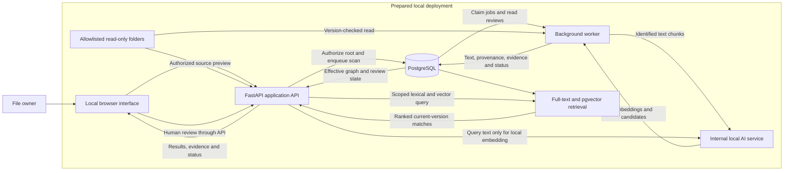
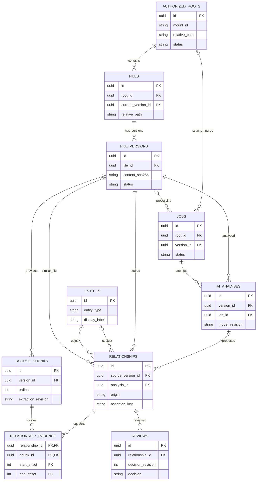
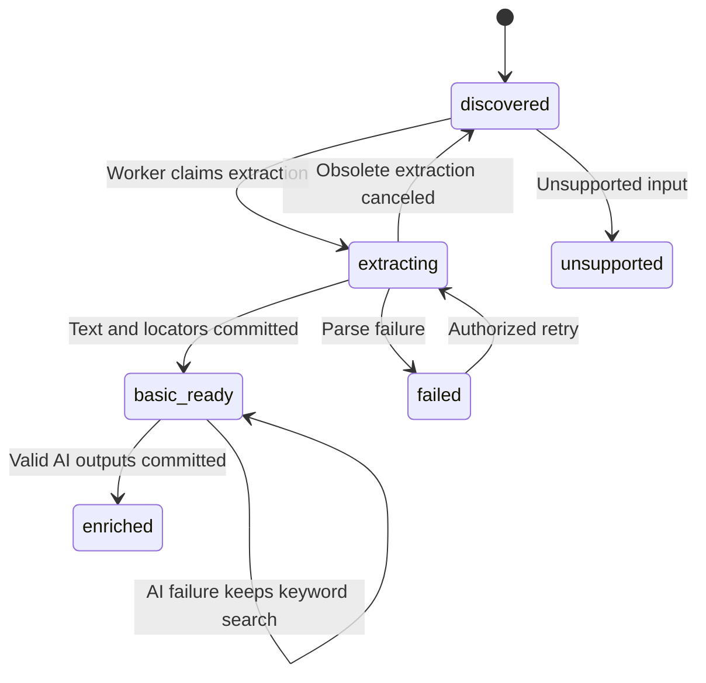
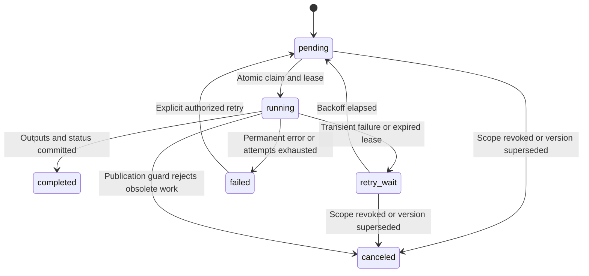
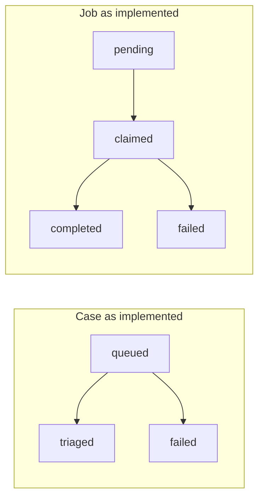

# File Management Assistant Architecture Proposal

MAIE 6000C Team 11 | Week 4 | 8 October 2026

We propose a local application for retrieving and connecting files inside user-authorized folders. Search and an evidence-backed graph are the delivery priorities. Original files remain read-only in the core release; moving, renaming, and undoing file operations are stretch goals.

This document is the technical design authority for the [Week 4 proposal and project plan](../submissions/week04/README.md). It describes a proposed system, not completed product functionality. The repository currently implements only the course starter's case-triage workflow. [Starter evidence and gap analysis](#starter-evidence-and-gap-analysis) distinguishes inspected implementation facts from planned changes.

## Problem and primary user

Our primary user is an individual who accumulates personal or project files across folders, needs to recover or connect their contents, and wants processing to remain on their own computer. The user may remember a concept, person, or project but not a filename. The product hypothesis is that semantic retrieval and inspectable relationships can help them locate the relevant source without reorganizing their collection.

The first input is a selected, authorized local directory. The first response is a durable directory/scan identifier and queued status, not a completed AI result. The file owner is the reviewer when an association is wrong. The graph is an additional discovery layer over the existing filesystem, not a replacement filesystem or a claim to know every real-world relationship.

### Release boundaries and PRD alignment

| Stage | Required outcome | Deferred capability |
| --- | --- | --- |
| W7 vertical slice | Manual scan of text PDFs across subfolders; asynchronous processing; keyword and semantic retrieval; PDF evidence; basic topic/person/project graph; saved review decisions; visible failure and recovery. | OCR, continuous monitoring, other document formats, broad entity coverage, and all filesystem organization. |
| R1 first usable release | W7 plus authorized-directory monitoring and pause/resume/rescan; DOCX, TXT, Markdown; scanned-PDF and PNG/JPEG OCR; files/people/organizations/projects/topics/events graph; metadata export and scope removal. | Move/rename preview, execution, operation history, and undo remain stretch goals. |
| Later evaluation | Consider grounded answers or summaries only after retrieval and evidence quality are demonstrated. | No commitment to a general assistant, cloud collaboration, audio/video, NAS, or multi-user support. |

This Week 4 scope decision supersedes the supplied PRD only for file organization: **F9-F11 and A9-A10 are stretch requirements/scenarios, not R1 acceptance gates**. F1-F5 remain W7/R1 requirements, and F6-F8/F12 remain R1 requirements. Revoking a directory's indexing authorization is still required in R1; it is not the deferred undo of a file move. R1 is the first usable product, not the W7 deadline.

Installation and preparation may download packages and model assets. After preparation, parsing, OCR, inference, indexing, querying, and graph exploration must work offline. We will publish supported OS, languages, corpus limits, and device requirements after compatibility measurements rather than assume universal support.

## Primary workflow

1. **Select a folder.** The user chooses a directory from a configured read-only mount and requests authorization and a scan. Recursive discovery includes its subfolders, not the whole computer.
2. **Validate scope.** The API validates the mount ID, canonical relative path, permissions, and request origin. It rejects traversal and links escaping the allowed directory.
3. **Record and acknowledge.** The API transactionally stores the authorized root and a pending `scan_root` job. It returns `202 Accepted` with `root_id`, `job_id`, and status before discovery or analysis finishes.
4. **Discover and queue files.** A background worker, a backend process that handles queued jobs outside an API request, claims the scan job, checks each supported source, persists its location and content version, and creates version-specific extraction jobs. Unsupported or inaccessible entries receive visible skipped/error reasons; repeated scans do not duplicate work.
5. **Extract and index.** The worker reads the expected file version, extracts text into located chunks, and commits basic keyword-search material. OCR is an R1 extension of this step. It queues local AI enrichment separately, so AI failure does not discard usable text.
6. **Run bounded local AI.** The internal AI service produces embeddings, semantic tags, entity mentions, and source-supported relationship candidates from identified chunks. It cannot browse the filesystem or execute instructions found in documents.
7. **Validate and persist.** The worker checks output structure, source references, and the current authorization/version before writing analysis provenance, entities, relationships, evidence, and final job state. Human decisions are not overwritten.
8. **Retrieve and review.** The user searches the authorized collection or follows a file/entity neighborhood, inspects a matching passage and source preview, and optionally confirms, corrects, or rejects an association. The API persists the review and updates the effective graph view.

Exception path: `processing -> failed -> visible reason -> bounded retry or user-requested retry`. A failed AI-enrichment job leaves extracted text available for keyword search and source inspection. A parse failure does not fabricate text. Other files continue processing, and search remains available while indexing is queued.

## Architecture flow

The target retains FastAPI, PostgreSQL, SQLAlchemy/Alembic, a separate worker, an internal HTTP AI service, Docker Compose, tests, health checks, structured logs, and metrics. PostgreSQL full-text search and pgvector provide the target hybrid retrieval path; graph nodes/edges remain relational records. The existing PostgreSQL image does not yet provide the proposed pgvector setup.

### Component responsibilities

| Component | Trigger and responsibility | Data read or written | Failure and scope boundary |
| --- | --- | --- | --- |
| Browser interface | User selects scope, searches, inspects evidence, or reviews a candidate. | Reads API results; submits scoped identifiers and review decisions. | Shows empty, queued, partial, failed, and no-results states distinctly; no direct database or arbitrary host-file access. |
| Application API | Validate user requests, store authorization/jobs/reviews, query search and graph, serve source preview. | Reads or writes PostgreSQL; reads authorized source files for preview. | Rejects requests for paths outside the authorized scope or for stale versions. Reports AI availability separately from API and database readiness. |
| PostgreSQL and retrieval adapter | Provides durable transactions and query execution for the API and background worker. | Authoritative metadata, jobs, versions, chunks, analysis, graph, reviews; derived text/vector indexes. | Database failure prevents acceptance; logs or a vector index do not substitute for durable state. |
| Worker and filesystem adapter | Claim scan/extract/enrich jobs; R1 reconciliation triggers reuse the same path. | Reads authorized originals and prior reviews; writes versioned outputs and outcomes. | Uses bounded work, transactional publication, leases, and retry; never writes originals. |
| Internal AI service | Worker analysis request or API query-embedding request. | Reads identified text; returns structured suggestions and embeddings, together with model metadata. | Missing model, invalid output, or timeout is visible; no cloud fallback, source mounts, or file-operation permission. |
| Operational tooling | Health probes, metrics scrapes, tests, and release verification. | Sanitized events, queue counts, latency, resource measurements. | Does not log document contents or search-query text, and does not use sensitive paths as metric labels. |

### Folder access and local deployment boundary

The user explicitly configures source folders before startup. The proposed Compose configuration maps them read-only into the API and worker, for example a host directory to `/sources/collection-a:ro`. A server-side allowlist maps a stable `mount_id` to that container path. The UI browses only directory entries beneath these mounts and sends `mount_id` plus a relative path; it is not a native picker granting access to any Windows path. Adding a new mount requires explicit configuration and a service restart.

Authorization is narrower than the mount: every scan, preview, and processing step rechecks canonical containment within both the configured mount and selected root. R1 initially rejects overlapping authorized roots, avoiding duplicate ownership and ambiguous revocation. Symlink/junction escapes are rejected; a read-only mount alone is not sufficient authorization. Invalid paths, unavailable mounts, and denied permissions are actionable errors.

Host exposure for the web interface and API is limited to loopback. The API validates browser Origin and Host headers and protects state-changing requests. AI and database traffic stays on the Compose network; host exposure is disabled or explicitly loopback-only for development. The starter's current published ports are not already loopback-restricted. The AI service receives no source mount. Model assets are prepared locally, and persistent application data stays in the documented PostgreSQL volume; only the originals stay in the selected host folders.

API startup/readiness must not depend on AI being healthy: the API needs its database, while model availability is a separate capability signal. The worker can still scan and extract when AI is unavailable. This requires adapting the starter's AI-health startup dependencies. Source preview is the guaranteed read-only access path; launching a native desktop application is optional, not a W7 dependency.

## Persistent entities and schema

The schema below is proposed, not an existing migration. Directory, file, job, analysis, entity, relationship, and review are the main domain records; versions, chunks, and evidence links are explicit supporting tables that preserve provenance and safe reprocessing instead of hiding those details in a generic JSON field.

All primary keys below are stable UUIDs except composite evidence keys. Mutable records have `created_at` and `updated_at`; immutable records have `created_at`. Timestamps are UTC. Status values are explicit constrained values, not arbitrary strings. API response status may combine these stored facts, but does not replace them.

| Table and purpose | Keys and important fields | Lifecycle |
| --- | --- | --- |
| `authorized_roots` defines permitted scope | PK `id`; configured `mount_id`, `relative_path`; `status`, `availability`, `monitoring_enabled`, `last_successful_scan_at`; timestamps. | Active, paused, revoking, revoked; availability is tracked separately. |
| `files` keeps location and stable identity | PK `id`; FK `root_id`, nullable FK `current_version_id`; `relative_path`, `name`, `filesystem_key` when reliable, `presence_status`, `last_seen_at`; timestamps. Unique `(root_id, relative_path)`. | Present, missing, unavailable, or excluded. Processing/staleness is derived from the current version. |
| `file_versions` identifies immutable content | PK `id`; FK `file_id`; `content_sha256`, `byte_size`, observed `mtime`, `status`, `parser_revision`; timestamps. Unique `(file_id, content_sha256)`. | Discovered, extracting, basic_ready, enriched, failed, or unsupported. Current/historical is determined separately by the file's current-version pointer. |
| `source_chunks` preserves text locations | PK `id`; FK `version_id`; `extraction_revision`, `ordinal`, `text`, `page_number` or `text_locator`, optional OCR bounds; nullable `embedding`, `embedding_model_revision`; timestamps. Unique version/revision/ordinal. | Text/locator is immutable per extraction revision; embeddings are rebuildable. |
| `jobs` owns asynchronous work | PK `id`; nullable FK `root_id` or `version_id`, exactly one: scan/purge targets a root, extract/enrich targets a version; `job_type`, `status`, `attempts`, `available_at`, `claim_token`, `lease_expires_at`, `error_code`; created/claimed/completed/updated timestamps. | Pending, running, retry_wait, completed, failed, or canceled. |
| `ai_analyses` records a model run | PK `id`; FK `version_id`, `job_id`; input/chunk fingerprint, model revision, prompt/rules revision, parameters, bounded raw output, validation outcome; start/completion timestamps. | Validated, invalid, or failed attempt; historical runs are retained until scope removal. |
| `entities` represents a candidate identity | PK `id`; `entity_type`, `display_label`, `normalized_label`; timestamps. Names are not unique keys. | Person, organization, project, topic, or event; IDs persist independently of spelling. |
| `relationships` stores a reviewable assertion | PK `id`; FK `source_version_id`, nullable FK `analysis_id`, optional `subject_entity_id`; exactly one object FK `object_entity_id` or `object_version_id`; `origin`, `relation_type`, `kind`, stable `assertion_key`, nullable model score; timestamps. Unique source version/assertion key. | AI origin requires analysis provenance; user origin records its actor in a review. `kind` separates source_supported, similarity, and user_tag; latest review determines effective state. |
| `relationship_evidence` links an assertion to text | Composite PK `(relationship_id, chunk_id, start_offset, end_offset)` with relationship/chunk FKs; verified quote; `created_at`. | Immutable evidence association within an extraction revision. |
| `reviews` preserves human decisions | PK `id`; FK `relationship_id`; `decision_revision`, decision, optional corrected subject/object entity FKs and relation type, reason, actor; `created_at`. Unique relationship/decision revision. | Append-only confirmation, correction, or rejection; the latest revision is effective. |

### Schema diagram

The diagram summarizes ownership and provenance; the table defines nullable endpoints and constraints. Enforce that a file's current version belongs to that file, each job has the target its type requires, and all evidence chunks belong to the relationship's source version. These need database keys/checks where possible and validation inside the publication transaction; separate valid FKs alone do not prove version consistency.

### Graph and retrieval representation

Files are graph nodes derived from `files` and their current version; entities use their own stable IDs. W7 uses `mentions` and `tagged_with` file-to-entity edges, representing semantic tags as topic entities. R1 can add typed entity-to-entity assertions when a passage supports them. A relationship with no subject entity uses the source file as its subject. A file-to-file `similar_to` edge targets a specific object version and is explicitly a recommendation, not factual identity, authorship, or causation.

Source-supported edges require verified passage references. Similarity uses the two version/model references and a score, not a fabricated supporting quotation. Scores are ranking signals, not calibrated correctness probabilities. Saved similarity suggestions can be reviewed; graph neighborhoods also derive related files from shared effective entity links. A user-authored topic tag is labeled as personal categorization, not a model-extracted fact, and needs no invented passage. Both endpoints must be current and within the requested active scope.

Keyword retrieval uses filename/path metadata and PostgreSQL full-text indexes on extracted chunks. pgvector stores local-model chunk embeddings; query embeddings use the same model revision. Combine lexical/vector ranks, deduplicate by file, and return the best located passages with match reasons. R1 filter options include root, file type, entity type, relationship type, and review state. Default PostgreSQL tokenization is not assumed to solve Chinese retrieval: W5 must validate declared languages and choose the tokenizer or literal-match fallback on the same corpus.

JSON is limited to bounded model payloads/configuration and format-specific locators. Root ownership, versions, graph endpoints, review decisions, and evidence links remain typed columns/FKs. Neither a graph database nor a separate queue broker is required for the first slice.

### Version and review consistency

- Hash and compare source metadata around extraction. If bytes change during the read, do not publish mixed-version evidence; rescan and queue the actual version. The write transaction rechecks root authorization, file/version, and claim token.
- `current_version_id` points to the latest observed content. Until its text is ready, metadata/status remain visible but old passages/edges are historical, not current search results. A late worker cannot publish active outputs or restore an older current pointer.
- Preview/evidence access verifies the source fingerprint and presence, not just the cached version ID. Detected changes or loss mark the source stale/missing, suppress its current passages/edges, and request reconciliation. A stale preview returns `409`; cached text does not prove the original still exists.
- Reuse records for unchanged location/content, and suppress duplicate active jobs for the same target/type. Content-identical files at different paths remain separate locations. A hash never authorizes deduplication or deletion.
- If content changes from A to B and later returns to A, reuse A's immutable version and valid outputs/reviews, and make it current again. Current/historical is not a terminal processing state. Requeue canceled or incomplete work if that reused version was never ready.
- Use reliable filesystem identity to reconcile an external move when available. Otherwise mark the old location missing and accept the new location separately, visibly reporting the uncertainty rather than merging by hash alone. Only a complete successful scan can establish that an entry is missing.
- Reprocessing matches stable, version-scoped assertion/mention identities; it does not use the job ID, model-run number, or label alone as identity. Preserve existing relationship IDs and all reviews. New candidates cannot silently recreate a reviewed rejection of the same meaning.
- Corrections select or create a distinct entity and store an override in `reviews`; raw AI assertions remain inspectable. Same-name people are not merged by normalized label. Changed source content gets fresh candidates and visible renewed review, not an automatic application of an old-version decision.
- Evidence text/locators are immutable per extraction revision. Parser changes create new chunks and revalidate evidence; saved review history is not deleted. Review requests use an expected decision revision and current source version, returning `409` on stale or concurrent edits.
- Pausing stops new work claims/discovery but does not revoke read authorization; an in-flight job may finish safely. Revocation immediately excludes a root from active queries and normal processing claims/publication. The `purge_root` job is the only exception: it can claim, retry, and commit cleanup on a revoking root. It removes derived text, vectors, assertions, and reviews, including cross-root similarity contributions; shared entities retain only other authorized support. Originals are untouched.

## State transitions

Job state and file-version readiness are separate. In particular, a failed enrichment job does not imply that keyword-searchable text was lost. File presence and root authorization are also independent of processing status. Observing new content changes the current-version pointer and makes the prior evidence historical; it does not destroy that prior version's readiness or reviews.

### State responsibility table

| Actor | Record | Allowed transition | Evidence retained |
| --- | --- | --- | --- |
| User through API | Authorized root | Active/paused changes; active or paused to revoking; monitoring on/off in R1. | Saved scope, timestamps, and authorized action. |
| Scanner/worker | Root availability and file presence | Available/unavailable; present/missing/unavailable; unchanged or new content version. | Successful scan time, file identity/hash, sanitized reason. A failed scan cannot mark the whole folder missing. |
| API or scan worker | Job | Creates pending scan or processing work; explicit failed-to-pending retry after validation. | Target, type, attempts/history, timestamps. |
| Worker/lease recovery | Job | Pending to running; completion, retry_wait, failure, or cancellation; retry_wait to pending. | Claim token, lease, attempt count, error code, outcome. |
| Worker | File version | Discovered to extracting to basic_ready to enriched; failure, unsupported, retry, or return to discovered after obsolete extraction is canceled. | Parser/model provenance, chunks, analysis validation, and independent current-version check. |
| User through API only | Effective relationship review | Candidate to confirmed/corrected/rejected; later decisions create a new review revision. | Append-only actor/reason/override tied to the stable assertion. Worker cannot change human decisions. |
| Purge worker | Authorized root | Revoking to revoked after index removal; failed purge leaves revoking with visible retry. | Cleanup job outcome and minimal root tombstone, not active retrieval entries. |

Unreviewed candidates are usable with clear labels; compulsory approval of every edge would obstruct retrieval. Rejected edges are suppressed from default discovery but remain inspectable in review history until scope removal. Corrections are shown as user overrides, not relabeled machine predictions.

## API and service boundaries

All routes below are proposed. They are distinct from the currently implemented `/cases`, `/jobs/{job_id}`, and `/triage` starter routes. The browser calls only the local application API; the worker calls the internal AI service. Only the API accepts user authorization/review actions, and no core route moves or edits original files.

### Application API draft

| Stage | Method and route | Minimum contract |
| --- | --- | --- |
| W7 | `GET /mounts` and `GET /mounts/{mount_id}/directories` | Return configured mount IDs/labels and permitted relative directory entries; validate the requested relative directory. |
| W7 | `POST /roots` | Accept `mount_id`, `relative_path`; atomically save read-only scope and initial scan job. Return `202`, root/job IDs and pending status. |
| W7 | `GET /roots` and `GET /roots/{root_id}` | Authorized scope, availability, scan status/counts; no AI completion implied by authorization. |
| W7 | `POST /roots/{root_id}/scans` | Persist a scan job; return `202` with root/job IDs and pending status. |
| W7 | `GET /files` and `GET /files/{file_id}` | Filter by root/status; return identity/location, current version, stage, sanitized failures, and related candidates. |
| W7 | `GET /jobs/{job_id}` and `POST /jobs/{job_id}/retry` | Read target/type/status/attempts; validate retry and return `202`. No duplicate active processing. |
| W7 | `POST /search` | Query and authorized root/filter IDs; ranked files, current version, passage/locator, match reason, and degraded-capability status. Query text is not put into a logged URL. |
| W7 | `GET /files/{file_id}/preview` and `GET /files/{file_id}/evidence` | Require expected version; scope and identity checks before read-only source access or located evidence. Never serve arbitrary user-supplied paths. |
| W7 | `GET /graph` | Root IDs plus a focus file/entity, filters, and bounded neighborhood limit; nodes, edges, evidence references, review state, and explicit similarity kind. |
| W7 | `POST /relationships/{relationship_id}/reviews` | Source version, expected review revision, decision, optional corrected entity/type and reason; append review and return effective result. |
| W7 | `POST /files/{file_id}/tags` | Accept current source version and a topic label; create/select the topic entity, save a user-origin `tagged_with` relationship and confirmed review, and return `201`. Optional supplied passage must be verified. |
| R1 | `PATCH /roots/{root_id}` | Toggle monitoring or pause/resume; resume schedules reconciliation. |
| R1 | `GET /roots/{root_id}/export` | Stream a local metadata export containing file/version references, tags/entities/links, evidence locators, provenance, and reviews; no original-file content copy required. |
| R1 | `DELETE /roots/{root_id}` | Explicit removal confirmation; revoke active visibility immediately and queue derived-index purge, returning `202` and job ID. Originals remain untouched. |
| W7/R1 | `GET /health/live`, `GET /health/ready`, `GET /metrics` | Process liveness, API/database readiness, and safe operational signals; model availability is separate from basic-search readiness. |

`POST /roots` authorizes and accepts the first scan in one transaction; the separate scan endpoint handles later rescans of an existing root. Both return before expensive discovery/analysis, even for large folders. Unknown IDs return `404`; invalid input returns `422`; unauthorized scope/origin returns `403`; outdated versions/review revisions or incompatible root state return `409`. An unavailable source is distinct from an empty result set. State-changing requests require the local session/origin protection established at startup.

### Internal AI contract

`POST /internal/embed` accepts bounded text and an expected embedding-model revision, returning a vector and model revision. The worker uses it for chunks; the API uses it for a query under a short configurable deadline. Embedding failure causes an explicitly degraded keyword search, not a failed API/database startup.

`POST /internal/analyze` accepts `version_id`, chunk IDs/text/locators, and the processing configuration. It returns typed tag/entity/relationship candidates with evidence chunk IDs and passage offsets, plus model/prompt/rules revisions. The worker validates these before publication. The AI service has no database-writing authority, arbitrary URL fetch, or filesystem-operation API.

## Worker and AI processing

### Job execution and recovery

W7 starts with one worker and one local inference slot to bound device load. PostgreSQL is the queue authority. Add a dispatcher for `scan_root`, `extract_file`, and `enrich_file`; R1 monitoring queues scans and scope removal adds `purge_root`. Scans do directory enumeration/hashing in the worker, not the request handler. Extraction commits located text and basic-search state before enrichment begins.

The target claim uses a short PostgreSQL transaction with `FOR UPDATE SKIP LOCKED` so concurrent workers skip jobs already locked by another worker. It increments the attempt count and records a unique claim token and lease. This is valid PostgreSQL locking syntax and supports multiple worker instances; the initial W7 setup has one worker, so the skip-locked clause is not required for W7 itself. Processing occurs outside the transaction. Heartbeats extend the lease; an expired lease becomes retryable work. Only the current lease holder can publish, preventing a recovered old worker from writing duplicate or outdated results. The current starter has none of these recovery guarantees.

Transient failures use bounded exponential backoff with jitter; start with a configurable maximum of three automatic attempts. Permanent unsupported/encrypted/unreadable input is skipped or failed with an actionable reason rather than retried indefinitely. A user can explicitly retry after fixing input/model access, preserving attempt provenance. Root revocation or a superseded version cancels obsolete processing; an obsolete extraction resets its incomplete version to discovered. The purge job alone may operate on a revoking root. Parsing/inference each have configurable time, memory/input-size limits and safe error codes; one bad document does not stop the queue.

Publication transactionally stores validated analysis, normalized relationships/evidence, and job/version outcomes. AI runs reference the immutable input/chunk fingerprint and producing configuration. Existing reviewed assertions are reconciled, not deleted and recreated. A failed or invalid AI response produces no unsupported factual edges; successfully extracted text remains keyword-searchable.

### Bounded analysis and human review

Local models propose tags, typed entity mentions, and relationships justified by passages. W5 evaluates inference runtime, embedding model, parser, and R1 OCR package on the declared hardware/languages; selected versions and prompts are pinned before the W7 demonstration. There is no training pipeline, generated cross-file answer, or requirement to review every candidate.

Validation checks output schema, allowed entity/relation types, chunk ownership, passage bounds, and correspondence to extracted text. Evidence demonstrates what the model used, not that its interpretation is true. Weak/invalid factual claims are withheld; similarity suggestions retain their distinct label. File contents are untrusted data: embedded instructions cannot authorize tools, network requests, scope changes, or file writes.

Review controls sit next to the suggestion and source. The user may confirm an acceptable edge, correct an entity/type, or reject it. Same-name entities need evidence or an explicit user decision before merging. Manual topic tagging uses the tag endpoint and the same entity/relationship/review store when AI is unavailable, with user provenance rather than a fabricated AI run or quotation. OCR failure is displayed, not replaced with invented text; PDF evidence uses a page and passage, other text documents use stable versioned headings/offsets, and images use a whole-image/region locator.

### Privacy and operational signals

No external document resources, remote processing fallback, or third-party telemetry are permitted after preparation. Host loopback/origin checks supplement folder authorization; they do not protect against a compromised OS, independently configured cloud-sync folders, user exports, or other applications with filesystem access.

Index removal is application-level cleanup, not secure disk erasure. It does not erase separately retained exports or backups, and the UI must explain those limits before confirmation.

Default logs contain service/job/file IDs, stage, duration, attempt count, and sanitized error codes, not file contents, queries, full sensitive paths, or raw model responses. Scraped metrics use bounded stage/status labels rather than IDs/paths. Track queue depth/age, completion/failure/retry counts, extraction/AI/query latency, and model availability. Worker heartbeat and stale-job signals complement API/AI health checks. A missing model makes AI readiness false without taking down basic retrieval.

## Starter evidence and gap analysis

These are source/configuration observations, not a claim that we executed the live lab or passed a restart test. Logs explain execution; database rows preserve workflow truth; metrics derive counts and durations.

### Persistence evidence map

| Lab question | Inspected evidence | Conclusion and limitation |
| --- | --- | --- |
| Which route starts the workflow? | [`services/api/app/main.py`](../services/api/app/main.py), `create_case`, `POST /cases`. | Existing route returns a case/job pair; no folder endpoint exists. |
| Which function creates the records? | Same API file, `create_case_with_job`. | Case and pending job are committed in one transaction. |
| Which model defines the FK? | [`services/common/models.py`](../services/common/models.py), `Job.case_id -> Case.id`. | Non-null case FK; it is not yet a general root/version job target. |
| Which function claims work? | [`services/worker/app/main.py`](../services/worker/app/main.py), `claim_next_pending_job`. | Pending to claimed, attempts incremented; plain select/update, no lease or claim lock. |
| Which function records failure? | Same worker file, `mark_job_failed`, called by `run_worker`. | Stores job error/failure and case failure; no retry endpoint/recovery. |
| Where is AI output stored? | Same worker file, `process_job`. | Label/summary/confidence on the case and completed job status in one commit. |
| Which test verifies creation? | [`tests/integration/test_api_case_flow.py`](../tests/integration/test_api_case_flow.py), `test_create_and_read_case_and_job`. | Verifies API creation/read-back with the test fixture, not production restart behavior. |
| Which smoke test covers processing? | [`tests/smoke/test_smoke_cases.py`](../tests/smoke/test_smoke_cases.py), `test_smoke_end_to_end_case_flow`. | Requires `SMOKE_BASE_URL` and a running stack; otherwise skips. Not run for this documentation checkpoint. |
| Which migration establishes persistence? | [`20260713_0001_create_initial_tables.py`](../alembic/versions/20260713_0001_create_initial_tables.py), `upgrade`. | Creates cases/jobs, FK and indexes; status columns are strings without transition enforcement. |
| What makes storage durable across normal stops? | [`compose.yaml`](../compose.yaml), `postgres_data` volume; API startup runs Alembic. | Configuration evidence only; an actual PostgreSQL restart verification remains required. |

### Existing starter state transitions

`CaseStatus.NEW` exists in the model, but the API creates a case directly as queued. Job attempts increase on claim, yet failed jobs are not automatically requeued and abandoned claimed jobs are not recovered. The triage service in [`services/ai/app/main.py`](../services/ai/app/main.py), `triage_text`, uses keyword rules and text shortening, not semantic retrieval or an entity model.

### Migration and test observations

The SQLAlchemy model describes desired Python structures; Alembic changes the real database. Preserve the initial migration and add reviewed migrations for the new schema, pgvector extension, constraints, and indexes. Update response schemas and worker dispatch together with models rather than assume a renamed case is already a file. Verify a clean migration path and an upgrade from the baseline without silently discarding starter records.

[`tests/conftest.py`](../tests/conftest.py) uses SQLite and `Base.metadata.create_all`, bypassing PostgreSQL/Alembic behavior. [CI](../.github/workflows/ci.yml) applies the migration to PostgreSQL, but its unit/integration suite still uses that SQLite fixture and does not start the worker/AI or run smoke tests. Also, `tests/integration/test_api_integration.py python` has a nonstandard filename and is not a normal pytest `.py` collection target. No test or runtime result is claimed for the proposed feature set.

### Keep adapt add risk conclusions

| Decision | Proposal consequence |
| --- | --- |
| Keep | API -> relational DB -> worker -> internal AI -> persisted result pattern; stack ADR, migrations, Compose, structured logs, health and basic metrics. |
| Adapt | Replace case-specific domain/contracts and triage placeholder; generalize jobs; add atomic claim/lease recovery and privacy-safe errors; remove AI startup dependence and restrict host ports. |
| Add | Browser UI, authorized read-only mounts, versioned ingestion/parsers, retrieval/pgvector, evidence-backed graph, persistent review, and declared R1 extensions. |
| Risk | Local inference/OCR quality, language tokenization, container path access, name ambiguity, stale evidence, unsafe retry, and unverified production persistence. |

The [baseline stack ADR](adrs/0001-baseline-stack.md) remains useful. The starter currently has no product frontend, source-directory mounts, indexing, search, graph, human review, or reliable retry. JSON logging does not already guarantee redaction; current raw exceptions and published ports require hardening.

## Risks and scope cuts

| Risk | Early evidence or mitigation | Responsible work area |
| --- | --- | --- |
| Local AI/OCR may be too slow or inaccurate on the target device. | W5 corpus/device/model feasibility check; bounded concurrency; explicit model availability; keyword/manual-review fallback. | AI/Model Development with QA/Testing |
| False relations, same-name entities, or poor OCR can mislead discovery. | Positive/negative and same-name fixtures; valid versioned evidence; distinct similarity labels; durable correction; no name-only merge. | AI/Model Development with Frontend |
| Browser/host/container paths may not map safely or consistently. | Allowlisted read-only mounts, mount/relative-path contract, canonical containment and symlink tests; W5 Windows/Docker verification. | Backend/Data |
| File changes and interrupted jobs can publish stale or duplicate results. | Content/version checks, stable IDs, atomic claims, leases, idempotency, successful-scan reconciliation, restart tests. | Backend/Data |
| Default tokenization or vector integration may not support declared languages. | Compare keyword and hybrid retrieval on the same declared corpus; validate extension/migrations and pin embedding revisions. | Backend/Data with AI/Model Development |
| R1 extensions and deployment hardening may exceed team capacity. | Milestone evidence review; finish W7 first; avoid a graph DB, second queue system, whole-collection graph, or autonomous assistant. | All roles |

**First scope cut: file organization.** No core mount or API grants original-file write access. Move/rename preview, confirmed execution, history, and undo are one deferred capability group. If later attempted, they need a separately reviewed authorization/safety boundary, conflict checks, per-operation outcomes, and their own acceptance tests; they cannot delay or fail R1.

The next simplifications are advanced graph layout, broad recommendation generation, and nonessential dashboards. Basic graph neighborhoods, search, evidence, correction, failure visibility, and privacy remain essential. Monitoring, format expansion, OCR, metadata export, and scope removal stay in the agreed R1 plan. W7's text-PDF/manual-scan limit is an explicit staging choice, not a silent removal of those R1 requirements. The role-owned timeline is maintained in the [Week 4 milestone plan](../submissions/week04/README.md#milestone-plan-and-ownership).

## Acceptance and verification

The scenarios below define evidence to collect after implementation. This Week 4 change provides design/documentation only; no row is marked passed by description. Use public, synthetic, anonymized, or instructor-approved fixtures with related/unrelated documents across subfolders.

| Scenario and PRD mapping | Stage | Observable acceptance evidence |
| --- | --- | --- |
| Durable input/result, A1 / F1-F3 | W7/R1 | Authorization, files, versions, jobs, results and evidence remain readable after a normal PostgreSQL/service restart without deleting volumes. |
| Cross-folder retrieval and graph, A2 / F3/F5, limited F8 | W7/R1 | Query wording differs from the filename; intended file is found across subfolders; a graph neighborhood leads to a supported related source; preview matches the displayed version/page/passage. |
| Review and ambiguity, A3 / F3-F4 | W7/R1 | Confirm/correct/reject candidates with same-name examples; restart and reprocess the same version; decisions persist and rejection is not silently restored. |
| Bad input isolation, A4 / F1-F2 | W7/R1 | Damaged/encrypted/unsupported/unreadable input has a visible safe reason; valid neighboring jobs finish; no fabricated text. |
| AI/embedding unavailable, A5 / F2/F5 | W7/R1 | API can start with unavailable AI; keyword/metadata retrieval, source access, manual tags and prior valid graph remain; AI failure is visible with no cloud request. |
| Repeated scan and worker recovery, A6 / F1-F4 | W7/R1 | Unchanged scans do not duplicate records/jobs; interrupt a worker and expire its lease; no permanent running state, duplicate publication, or lost review. |
| Monitoring and external changes, A7 / F6 | R1 | New/modified/missing/moved/inaccessible files reconcile; pause/resume/rescan works; stale evidence is not current; ambiguous moves are reported. |
| Formats and OCR, A8 / F7-F8 | R1 | DOCX/TXT/Markdown, readable scans and PNG/JPEG are processed with stable locators; poor OCR is flagged; all declared entity types and review filters work. |
| Prepared offline behavior and logging, A11 / Q1/Q3 | W7/R1 | Repeat the core path disconnected after setup; inspect traffic/default logs; no external content-processing calls or document/query text leaks. |
| Scope/export/removal, A12 / F6/F12 | R1 | Reject out-of-root/traversal/link access; export includes meaningful metadata and reviews; revoked content disappears from active search/graph and purge completes without changing originals or unrelated roots. |
| Version and review races / F3-F4/Q2-Q3 | W7/R1 | Change a file during extraction, restore content A after A-to-B changes, submit a stale review, and attempt late publication after revocation; stale actions fail visibly, valid A evidence/reviews are reusable, and current data is not overwritten. |

A9-A10 / F9-F11 are stretch-only filesystem-operation checks, excluded from the R1 pass list. Across every core scenario, originals must remain unchanged and unauthorized reads/writes, current-version evidence errors, or lost reviews are release blockers.

### Verification layers and measurements

Unit tests will cover scope/path validation, parsing locators, candidate/evidence validation, graph/review logic, and sanitized errors. PostgreSQL integration tests must apply Alembic and exercise constraints, vectors, transactional enqueue/publication, lease competition, and review retention; SQLite is insufficient evidence for these behaviors. Compose smoke tests will cover the whole prepared local path, restart persistence, AI degradation, and source preview. UI checks distinguish no results, incomplete indexing, degraded AI, and missing source.

Before defining numeric release thresholds, record the device/OS, model/parser/OCR versions, languages, corpus size/formats, and cold/warm conditions. Compare a filename/keyword baseline with hybrid search on known-file tasks. Measure relevance and time to find a source, evidence validity, review/correction outcomes, indexing/query latency, peak memory, queue age, and recovery outcomes. Report measured results and limitations, not unsupported second-level or accuracy promises.

W04 document verification covers cross-file links/anchors, diagram structure, state/API/schema consistency, PRD scope mapping, and source-evidence accuracy. Product tests and team sign-off remain future work. Review responsibilities and the AI Use Statement are in the [submission summary](../submissions/week04/README.md).

