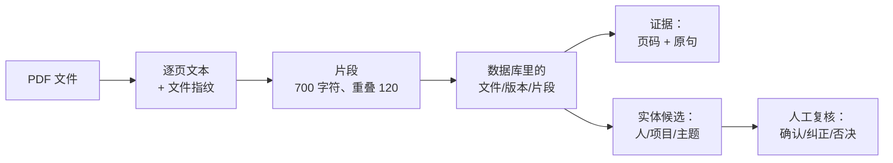

# 从小白到能自己验：这套系统的审查报告

Owner: B. 写于 2026-10-17。对象：不写代码也想确认"它到底对不对"的读者。

这份报告不是"我们的系统很牛"，而是**把每个结论拆到你能用小学算术和几条命令重现**。
读完你应该能做到两件事：**自己跑一遍**，以及**判断一个说法有多强**。

---

## 0. 怎么用这份报告

分三层，不必一次读完：

1. **读懂**：第 1–2 节。每个概念配一个 30 秒就能验证的小实验。
2. **手验**：第 3 节。七个核心机制，每个都是"主张 → 为什么 → 你自己敲什么 → 应该看到什么"。
3. **复核结论**：第 5 节。哪些结论强、哪些只是样本、哪些没验。

所有命令都在仓库根目录 `/Users/zhangjintong/MAIE6000C-starter-jintong-zhang` 里执行。

如果这是第一次拉下仓库，或者刚刚改过 `pyproject.toml`，先重建一次测试镜像：

```
docker compose build api
```

这一步不能省。镜像里保存着依赖库和测试文件的旧副本；源码目录可以挂载进容器，
但 Python 包不会因此自动安装。我第一次按旧镜像运行，`pypdf` 缺失，12 个测试文件
在收集阶段就失败。重建后才是真正的代码结果。

---

## 1. 这个系统在做什么

一句话：**把一堆 PDF 变成"可以指着页码给人看"的文本，并且让人的判断可以追溯。**



**为什么每一步都要存**：因为最后用户会问"这句话出自第几页"。如果中间任何一步丢了页码，
最后就答不上来——这就是整套设计的起点。

---

## 2. 六个必备概念（每个都配一个 30 秒小实验）

### 2.1 哈希：给"内容"算指纹

把任意长度的数据压成固定长度的一串十六进制字符。**内容变一个字符，指纹几乎全变。**

自己验（在终端里跑）：

```
printf 'hello' | shasum -a 256 | cut -c1-16
printf 'hellp' | shasum -a 256 | cut -c1-16
```

应该看到（实测）：

```
2cf24dba5fb0a30e
fdd7585e08c4e2af
```

只把一个 `o` 换成 `p`，16 位里一位都没对上。这就是"**版本 = 内容指纹**"能成立的原因：
文件被改过，指纹一定不同，系统就能发现"这段文字不是现在这份文件的"。

### 2.2 偏移与切片：`[开始:结束]`

程序里说"第 100 到 120 个字符"叫 **offset（偏移）**。Python 的写法是 `s[100:120]`，
包含 100、不包含 120，所以一共 **20** 个字符。

这条很重要：**页码和偏移一起，才构成"可核查"**。只给页码，读者还得自己在整页里找；
给了偏移，程序能直接把那句话框出来。

### 2.3 页码与重叠：一段算术

系统把每页切成 700 字符的片段，相邻片段**重叠 120 字符**，而且**片段绝不跨页**。

用一个真实例子手算（这是我用代码跑出来的）：一页 400 个不重复的词，共 **2399** 字符。

| 片段 | 长度 | 首个词 | 末个词 |
|---|---|---|---|
| 1 | 695 | w0000 | w0115 |
| 2 | 695 | w0096 | w0211 |
| 3 | 695 | w0192 | w0307 |
| 4 | 671 | w0288 | w0399 |

看点有三个：

1. **为什么是 695 而不是 700？** 因为切点会往前找一个空格，避免把单词劈开。
2. **重叠怎么算？** 第 2 段从 `w0096` 开始，第 1 段到 `w0115` 结束，重叠了
   `0115 - 0096 + 1 = 20` 个词；每个词 6 个字符、去掉一个空格 → **119** 字符，
   约等于配置的 120。少的那 1 个就是被 `strip()` 去掉的空格。
3. **为什么片段数不是 `2399 / 700 = 3.4 → 4` 这么简单？** 因为每段只前进
   `700 - 120 = 580` 字符：`(2399 - 700) / 580 = 2.93`，向上取整 3，加第一段 = **4 段**。

### 2.4 状态机：一个文件只有有限的几种结局

```
discovered → extracting → basic_ready        （成功）
                        → unsupported        （加密/损坏/无文字层/非 PDF）
                        → failed             （内容变了/文件没了/处理失败）
```

**关键点：每一次进入 `extracting` 都必须有一个出口。** 如果某条路径出错却没人写结局，
这条记录会永远停在"处理中"——看界面的用户会以为它还在跑。这正是本次审查修掉的缺陷之一。

### 2.5 事务：要么全做，要么全不做

"替换一个版本的片段"要一次完成：删旧、写新。如果写到一半失败，**旧片段必须原样还在**。
否则一次失败的重新解析会把内容清空，比不跑更糟。

同样的规则适用于一批关系证据：第 1 条合法、第 2 条非法时，不能把第 1 条留在
"待提交"状态。函数报错后必须整批回滚，否则调用方下一次普通提交会把半批数据永久保存。

### 2.6 唯一约束：让数据库帮你防重复

复核记录的版本号在数据库上有一条唯一约束：同一个关系、同一个版本号，**只能存在一行**。
两个人同时提交同一版本时，第二个会被数据库直接拒绝——这就是"不会悄悄覆盖"的最后一道保险。

### 2.7 样本与概率：`12/12` 和 `3/4` 不是一回事

- **12/12**：抽了 12 段，全部对上。它证明"**在这 12 段里没发现错误**"，不等于"永远不出错"。
  样本越大、越随机，结论越强。
- **3/4**：这是对候选列表准确率**估计**，不是保证。它告诉你"如果要自动当成事实，会错四分之一"，
  所以系统设计成"候选 + 人工确认"。

---

## 3. 七个核心机制：主张、理由、手验

### 3.1 逐页提取，并且记住"这份文字来自哪份字节"

**主张**：每个片段都能回答"来自哪个文件、哪一版、第几页"。

**为什么**：页码是给人看的定位；内容哈希是给机器验的身份。两者缺一不可。

**你自己验**（三行）：

```
docker compose run --rm --no-deps \
  -v "$(pwd)/services:/app/services" api python -c "
from services.parsing.pdf import extract_document
doc = extract_document('tests/fixtures/parsing/normal.pdf')
print('页数:', doc.page_count, '指纹前 8 位:', doc.content_sha256[:8])
print('第 1 页前 40 字:', doc.pages[0].text[:40])
"
```

**应该看到**：页数 ≥1、指纹 8 位十六进制、第 1 页有一段真实文字。
**如果坏了会看到**：`UnsupportedDocument`（文件本身有问题）或指纹每次运行都不同（说明读取不稳定）。

### 3.2 切块：700 字符、重叠 120、绝不跨页

**主张**：每个片段不超过 700 字符；同一页相邻片段有重叠；没有任何片段跨页。

**为什么**：

- **不跨页**：页码要对得上，片段一旦跨页，"第 7 页"就变成"第 6–7 页之间"。
- **重叠**：一句话被切断时，至少有一个片段是完整的。

**你自己验**：用第 2.3 节的例子，或直接跑：

```
docker compose run --rm --no-deps \
  -v "$(pwd)/services:/app/services" -v "$(pwd)/scripts:/app/scripts" \
  -v "/Users/zhangjintong/HKUST/HKUST-6000C:/fixtures:ro" api \
  python scripts/check_parsing_quality.py "/fixtures/Week 5 — Lab.pdf"
```

**应该看到**：`max` 列 ≤ 700、`overlap` 列接近 120、`docs:fragments found on their page` 是满的。

**这次的补充**：我写了 300 种"故意刁难"的页面（超长单词、只有标点、中文、长段落……），
**没有一种能产出超过 700 的片段**——这条现在有测试钉住。

### 3.3 写库：替换，而不是追加；没变的片段保留身份

**主张**：同一版本重新解析 = 用新的一组片段替换旧的，不会重复；**内容没变的片段保留原来的
行 id**。

**为什么保留 id**：证据表通过 `chunk_id` 指向片段（外键、级联删除）。如果每次重解析都把
所有片段删掉重建，"证据"就会跟着被数据库删掉——关系还在，引文却空了。这是之前真实发生过的
缺陷。保留不变的片段，等于保留指向它的证据。

**你自己验**：

```
docker compose run --rm --no-deps \
  -v "$(pwd)/services:/app/services" -v "$(pwd)/tests:/app/tests" api \
  pytest -q tests/unit/test_parsing_persist.py -k "identical or replaced"
```

**应该看到**：`2 passed`（"相同内容保留 id" 与 "内容变了换新行" 各一条）。
**如果坏了**：重解析后旧 id 消失 → 证据被级联删除 → 关系页显示"没有引文"。

### 3.4 状态机：坏文件不会让整批停下，也不会永远卡在"处理中"

**主张**：七种结局各有自己的状态与理由码；任何一次进入 `extracting` 都会有出口。

| 结局 | 状态 | 理由码 |
|---|---|---|
| 正常 | `basic_ready` | — |
| 加密 / 损坏 / 无文字层 / 非 PDF | `unsupported` | `encrypted` 等 |
| 读之前或读之中内容变了 | `failed` | `source_changed` |
| 文件不见了 | `failed` | `file_missing` |
| 处理本身失败（读库、写库） | `failed` | `processing_failed` |

**你自己验**：

```
docker compose run --rm --no-deps \
  -v "$(pwd)/services:/app/services" -v "$(pwd)/tests:/app/tests" api \
  pytest -q tests/unit/test_parsing_handler.py
```

**应该看到**：`13 passed`，其中包含"坏文件被记录而不是抛异常""一个好的文件跟在坏文件后面
仍然能完成""读取中崩溃、写库失败或最后状态提交失败都不会留下 `extracting`"。

### 3.5 证据读取：五种情况必须拒绝

**主张**：只有当"片段还在、版本还是当前版本、文件还在、目录授权还在"时，才把原文交给用户。

| 情况 | 理由码 |
|---|---|
| 片段不存在 | `chunk_not_found` |
| 版本被更新的内容取代 | `version_superseded` |
| 从没标记过当前版本 | `no_current_version` |
| 文件不在磁盘上 | `file_missing` |
| 目录授权被撤销 | `root_revoked` |

**为什么**：**"查不到"和"曾经有效"是两件事**。界面必须能区分——前者可能让用户重试，
后者要告诉用户"你看到的是历史内容"。

**你自己验**：

```
docker compose run --rm --no-deps \
  -v "$(pwd)/services:/app/services" -v "$(pwd)/tests:/app/tests" api \
  pytest -q tests/unit/test_parsing_evidence.py
```

**应该看到**：`8 passed`（正常读取 1 条 + 五种拒绝 + 两条区分度断言 + 10 条页码样例）。

### 3.6 人工复核：只追加 + 版本号 = 不会被悄悄覆盖

**主张**：复核永远不会覆盖上一条；两个人在同一版本上同时写，只有一个人成功，另一个人收到
明确的冲突。

**为什么需要"版本号"**：光有"最后写入者获胜"的话，A 的判断会被 B 静默覆盖，而历史里看不
出发生过什么。要求调用方说明"我看到的是第几版"，冲突就变成可见的、可处理的。

**你自己验**（这条会打印完整时间线）：

```
docker compose run --rm --no-deps \
  -v "$(pwd)/services:/app/services" -v "$(pwd)/scripts:/app/scripts" \
  -v "$(pwd)/tests:/app/tests" api \
  python scripts/demo_relation_review.py tests/fixtures/relations/entities.pdf
```

**应该看到**：

```
reviewer A confirms ...: revision 1
reviewer B holds a stale view and is refused: review_conflict
reviewer B re-reads and rejects: revision 2
```

### 3.7 关系证据：引文必须真的属于这份文档

**主张**：一条关系引用的 `chunk_id` 必须属于它声明的文件版本；引文的起止位置必须
真的指向实体标签，引文还必须包含这个标签。

**为什么**：数据库外键只能保证"这个 chunk 存在"，不能保证它属于当前版本。若只按
`chunk_id` 连接，另一份文档里一段完全不相干的句子会被显示成这条关系的证据。数据库
外键也没法检查 `[开始:结束]` 是否落在文本内，因此必须在写入前校验，在读取时再查一遍。

**你自己验**：

```
docker compose run --rm --no-deps \
  -v "$(pwd)/services:/app/services" -v "$(pwd)/tests:/app/tests" api \
  pytest -q tests/unit/test_parsing_graph.py \
  -k "another_version or chunk_text_changed"
```

**应该看到**：`2 passed`。一种情况把证据故意换成另一版本：结果必须是
`evidence_missing=True`、空引文、无页码。另一种情况把原文改掉：结果同样不能继续展示旧引文。

---

## 4. 这次审查发现并修掉了什么

审查不是"再跑一遍测试"，而是**针对每个主张去找反例**。下面每一条都是先复现、再修、再加测试。

| # | 缺陷 | 怎么发现的 | 修法 |
|---|---|---|---|
| 1 | **提取阶段崩溃时，版本永远卡在 `extracting`** | 人为让解析函数抛异常，然后把数据库里的行读回来 | 把提取、切块、写库放进同一个异常处理：任何失败都先写 `failed`/`processing_failed`，再上抛给 worker |
| 2 | **片段序号有洞（1,2,5）也能写进库** | 直接调用写入函数，传一个带洞的集合 | 校验改为"必须是 1..N 连续"，带洞直接拒绝 |
| 3 | **"最长 700" 只有一个例子支撑** | 用 300 种不同形状的页面（超长单词/中文/长段落…）去试探 | 收紧测试到真正的 700，并加上"任何形状都不超过 700"的属性测试 |
| 10 | **关系会展示另一份文档里的句子** | 建两个文件版本，把关系证据的 `chunk_id` 换成第二版的 | 查询时同时要求 `chunk.version_id == relationship.source_version_id`，读取时再核对偏移和引文 |
| 11 | **一批关系失败后留下半批待提交数据** | 第 1 条合法、第 2 条引用不存在的 chunk；捕获错误后再提交 session | 写入前整批校验；任何异常都 `rollback()`，用"错误后再 commit"的测试钉住 |
| 12 | **越界的偏移和不含标签的引文也能写进库** | 传入 `start=999`，以及合法偏移配无关引文 | 新增 `InvalidRelationEvidence`，要求偏移在文本内、切片等于标签、引文包含标签 |
| 13 | **同一实体的多次提及只留下最后一条证据** | 给同一实体的两个 chunk 调用写入函数 | 每个关系只清空一次旧证据，然后保留这一批里的全部不同引文；测试断言 1 个关系、2 条证据 |
| 14 | **规则升级后仍显示旧的生产者版本** | 用 `rules-v1` 写入，再用 `rules-v2` 重跑 | 找到既有关系时同步更新 `producer_revision`，避免来源标签说谎 |
| 15 | **最后一次状态提交失败时仍可能停在 `extracting`** | 让第三次 `commit()` 抛错，再回滚并重新从数据库读数 | 最终状态更新放进同一个异常边界；失败后先回滚，再记录 `failed`/`processing_failed` |
| 16 | **不支持或失败的文档没有记录解析器版本** | 读取坏文件的 version 行，发现 `parser_revision=None` | 所有处理出口统一写入 `parsing-v1`，这样排错时能知道是谁尝试过 |

**这些都不是"跑挂了"，而是"看起来没问题、其实没有保证"。** 这类缺陷最危险，因为测试
一直是绿的。第 10–16 条是切换模型后重新从零审查新增的发现；第 1–9 条是前两轮记录，
其中第 4–9 条在 `B-fixes.md` 里保留了复现细节。

（更早的一轮独立审查还发现并修掉了：读取过程中文件被改写却仍发布、写库失败卡状态、
测试库不开外键所以级联从未生效、带通用任务时降级失败、页码核对会"自己检自己"等等。
详细记录在 `submissions/week07/B-fixes.md`。）

---

## 5. 结论有多强：诚实说明

| 结论 | 有多强 | 为什么 |
|---|---|---|
| 全量测试 112 通过、1 跳过 | 强 | 每条都能重跑；但"通过"只覆盖被写出来的测试 |
| 页码归属 12/12 | 中 | 抽样 12 段，不是全部；但用了**另一个 PDF 库**独立判断 |
| 66 页 0 坏字符 | 中 | 语料只有三份课件；换一批文件结论要重测 |
| 40 份文档 0 崩溃 | 中 | 是"这台电脑上的 PDF"，语料会变（现在已经是 40 份而不是 38 份） |
| 实体候选约 3/4 准确 | 弱（估计） | 人工估的，样本有限；所以系统只把它当"候选" |
| 重解析不会丢证据 | 强 | 有测试；但只在"内容没变"时保留 id，内容变了证据本来就应该失效 |

**没验证的**：真实浏览器里的完整流程（依赖 A 的路由）、Windows 上的运行、第二台电脑、
D 的正式语料。这些不是"没做"，而是**不在 B 的边界内**，都在交接单里写明了。

---

## 6. 十分钟自检清单

在仓库根目录依次执行，每条都给出"应该看到什么"。新环境先运行第 1 行；它只准备依赖，
不是测试项。

| # | 命令 | 应该看到 |
|---|---|---|
| 1 | `docker compose build api` | 最后一行是 `Built`；新环境必须先做 |
| 2 | `docker compose run --rm --no-deps -v "$(pwd)/services:/app/services" -v "$(pwd)/tests:/app/tests" -v "$(pwd)/scripts:/app/scripts" -v "$(pwd)/alembic:/app/alembic" api pytest -q -rs` | `112 passed, 1 skipped`；跳过原因是 smoke test 没设置服务地址 |
| 3 | 同上，把 `pytest -q -rs` 换成 `ruff check .` | `All checks passed!` |
| 4 | `pytest -q tests/unit/test_parsing_chunking.py` | `17 passed`（含属性测试） |
| 5 | `pytest -q tests/unit/test_parsing_handler.py` | `13 passed`（状态机全覆盖） |
| 6 | `pytest -q tests/unit/test_parsing_graph.py` | `17 passed`（证据与复核边界） |
| 7 | `pytest -q tests/unit/test_parsing_relations.py` | `15 passed`（关系写入原子性） |

**判断标准**：不看"绿不绿"，看**数量对不对**、以及**跳过的那一条是什么原因**
（`-rs` 会打印原因）。

---

## 7. 还没完成的（以及归谁）

| 事项 | 归谁 | 状态 |
|---|---|---|
| 扫描器（把磁盘上的文件变成 `files`/`file_versions`） | A | 只有决策与配置，代码未写 |
| worker 分发（认领 `extract_file` 任务） | A | 未接 |
| 路由（`/mounts`、`/files`、证据、关系、复核） | A | 只有 B 的 `/roots` 存在 |
| 检索接入（C 的搜索读 B 的表） | C | 已实现，但用另一套表；需重映射 |
| 前端接真接口 | D | 现在用 mock；接口缺 4 个 |
| 正式语料重跑 12/3/1 | B，等 D | 命令不变，换文件即可 |

**一句话**：**B 这一块可以独立验证、也经得起抽查；能不能演示，取决于 A 的三件事什么时候
接上。**
