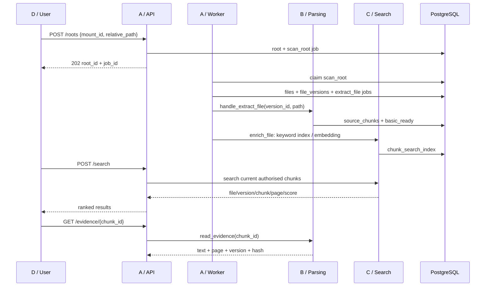

# Team 11 W7 共享集成契约

- 版本：**v1.1 release candidate，等待 A 确认公共 schema 后封板**
- 日期：2026-10-17
- 适用分支：`w7-scan-dispatch`（A）、`w7-parsing`（B）、
  `feat/c-search-model-evaluation`（C）、`Role_D`（D）
- 最终架构依据：`week04-architecture-proposal` 中的 `docs/architecture.md`

这份文件解决四人在合并前必须共同决定的事情：**一张数据表能不能有两份定义、
搜索结果的 chunk 能不能核对原文、异步任务到底有哪些状态、前端最终调用什么接口。**
它不是分支现状的说明，而是合并时必须达到的目标状态。

## 最短执行摘要

| 成员 | 现在必须做什么 |
| --- | --- |
| A | 先把 B 合入 A+B 集成分支；保留 B 的文件/版本/chunk 主表；实现扫描、`current_version_id`、worker 分发和 canonical 路由；审核 C 的增量迁移 |
| B | 保持 chunk ID 和字段不变；在 A 的集成分支提供解析/证据/复核入口；修正 `paused` root 仍可读取证据的语义；不再新建第二套搜索表 |
| C | 删除自己的 `source_files/source_versions/source_chunks`；新增 `chunk_search_index`；迁移接到 `445f908b73b4`；改写 `indexing.py`、`retrieval.py` 和测试 |
| D | 接受 canonical API 的扁平 root/job 响应；搜索调用 `POST /search`；证据调用 `GET /evidence/{chunk_id}`；使用统一小写错误码 |

一句话：**A+B 先形成一个唯一数据底座，C 在它上面加搜索索引，D 最后接真实接口。**

### 当前符合情况（不是完成声明）

| 项目 | 当前状态 | 合并前动作 |
| --- | --- | --- |
| B 主表与稳定 chunk ID | 已实现 | 保持 |
| B `paused` root 的证据读取 | **不符合**：现在只接受 `active` | 允许 `active/paused`，拒绝 `revoking/revoked` |
| A 扫描、current pointer、worker | **尚未实现** | 按第 3–5 节实现 |
| A mounts/files/jobs/evidence 路由 | **部分或尚未实现** | 按第 6 节组装 |
| C 搜索算法和 embedding | 分支内可运行 | 保留 |
| C 数据库 schema | **不符合**：仍是三张独立表 | 改为 `chunk_search_index` |
| C 搜索字段 | **不符合**：仍用 `version_number/page_start/page_end` | 改 `version_created_at/page` |
| D 前端 | **尚未接真实搜索** | 改 API adapter 并调用 `/search` |
| D 错误码 | **不符合**：仍识别大写码 | 改 canonical 小写码 |
| Alembic | **不符合**：A/C 两条 head | 接成一条链 |

这张表必须随实现更新。契约写对不等于代码已经满足。

## 0. 生效规则

以下规则是合并阻断项。没有做到的项目不能写成“已经接通”。

1. **只保留一套文件、版本和 chunk 主表。** B 的 `files`、
   `file_versions`、`source_chunks` 是唯一正文来源。
2. **C 只保存搜索派生数据。** embedding、规范化搜索文本和搜索词放在
   `chunk_search_index`，不再创建 C 自己的文件、版本或 chunk 表。
3. **所有 chunk ID 必须来自同一个 `source_chunks.id`。** 搜索结果、原文证据、
   关系证据和复核必须能通过这个 ID 相互对应。
4. **Alembic 最终只能有一个 head。** 文件改名不能解决多条迁移链；必须把
   `down_revision` 接到真实前驱。
5. **共享文件由 A 最终落地。** `services/common/`、`alembic/`、
   `services/api/app/main.py` 和 worker 分发由 A 审核并合并。B/C 提交字段和
   行为意图，不在各自分支制造互相覆盖的第二套定义。
6. **机器可读值使用小写下划线。** 时间使用 UTC；状态和错误码不做中文、大小写
   或别名转换后再存库。`root/file/version/chunk/entity/relationship/review/chunk_index`
   的业务 ID 是字符串 UUID。`jobs.id` 是唯一例外：W7 继续使用现有的自增整数，
   公开 API 也返回 JSON number，避免无关的主键迁移。
7. **错误不能伪装成空结果。** 文件不存在、版本过期、目录撤销、AI 降级和真正
   没有搜索结果必须可区分。
8. **原文只读。** API、worker、搜索和复核都不能移动、重命名、写回或删除用户的
   原始文件。

本契约发生变更时，先修改本文件并说明原因，再改代码。不能让代码和契约悄悄分叉。

---

## 1. 当前分支快照与合并顺序

本版编写时核对到的远端状态：

| 成员 | 分支 | 快照 | 职责 |
| --- | --- | --- | --- |
| A | `w7-scan-dispatch` | `7b084e5` | 授权、扫描、任务分发、挂载、公共模型、路由组装 |
| B | `w7-parsing` | `a91d521` | PDF 解析、chunk、证据、关系、复核 |
| C | `feat/c-search-model-evaluation` | `482ac32` | 中英关键词、embedding、hybrid 检索、评测 |
| D | `Role_D` | `eb656ca` | 文件夹选择、进度、结果、证据与复核页面 |

### 1.1 合并方向

```text
starter main
    ├── A: scan / jobs / mounts
    └── B: parsing / evidence / review
             ↓
      A+B integration branch
             ↓
      C adapted to canonical schema
             ↓
      D connected to canonical API
             ↓
         team main
```

1. A 先把 B 合进 A 的集成分支。当前实测无冲突。
2. C 再合并 A+B，删除自己的三张重复表，把检索改成使用 canonical schema。
3. D 最后接真实 API，不再以 mock 或浏览器本地过滤冒充搜索完成。
4. 只有“合并后的完整链路测试通过”后，才允许把集成分支合入 `main`。

不得把 C 的 `20261015_0002_source_search` 和 B 的
`c2d1ac693a0e → 318ab5be35e0 → 445f908b73b4` 直接并列保留。它们是两条
从 starter 分出的迁移链，并且都试图创建 `source_chunks`。

---

## 2. Canonical 数据模型

### 2.1 唯一主表

| 语义 | 唯一表 | SQLAlchemy 模型 | Owner |
| --- | --- | --- | --- |
| 已授权目录 | `authorized_roots` | `AuthorizedRoot` | A |
| 文件位置与当前版本指针 | `files` | `FileRecord` | A |
| 不可变内容版本 | `file_versions` | `FileVersion` | A |
| 带页码的原文片段 | `source_chunks` | `SourceChunk` | A/B 边界；B 生成 |
| 异步任务 | `jobs` | `Job` | A |
| 实体候选 | `entities` | `Entity` | A 审核，B 生成 |
| 关系候选 | `relationships` | `Relationship` | A 审核，B 生成 |
| 关系证据 | `relationship_evidence` | `RelationshipEvidence` | A 审核，B 生成 |
| 人工复核历史 | `reviews` | `Review` | A 审核，B 生成 |
| 搜索派生数据 | `chunk_search_index` | `ChunkSearchIndex` | A 审核，C 生成 |

以下 C 表必须在合并后消失：

- `source_files`
- `source_versions`
- C 自己定义的 `source_chunks`

**这不是删除 C 的整条搜索功能。** 删除范围仅限 C 为独立演示复制的持久化
schema。C 仍然保留：

- 中英文归一化、tokenize 和查询限制；
- embedding HTTP client、本地 E5 模型和向量校验；
- keyword / semantic / hybrid 排序与降级逻辑；
- AI `/embeddings` 接口；
- 评测 fixtures、gold queries、质量记录和评测脚本；
- `chunk_search_index` 及其索引、向量、降级和评测测试。

需要实质调整的生产文件主要只有 `services/search/indexing.py` 和
`services/search/retrieval.py`，因为它们直接访问了另一套模型名称。其他搜索
能力可以复用。测试也不是全部重写：行为断言保留，创建 fixture 和少量响应字段
改成 canonical schema。

### 2.2 字段含义

#### `files`

- `id`：稳定文件 ID，不随内容版本变化。
- `root_id`：必须指向一个已授权目录。
- `current_version_id`：指向扫描最近观察到的版本；由 A 的扫描事务维护。
- `relative_path`：相对于授权目录的路径，不存宿主机绝对路径。
- `name`：显示文件名。
- `presence_status`：`present`、`missing`、`unavailable`。

关键规则：

- 新内容出现时，在**扫描事务**中创建或复用 `FileVersion`，并更新
  `current_version_id`。
- 文件暂时消失时保留历史指针，但 `presence_status != present` 的文件不进入
  正常搜索，也不能作为当前证据返回。
- 相同路径、相同 SHA-256 重复扫描不创建重复版本和任务。
- 相同内容出现在不同路径时仍是两个 `files` 记录，不按哈希删除或合并。

#### `file_versions`

- `id`：不可变版本 ID。
- `file_id`：所属文件。
- `content_sha256`：该版本实际读取字节的 SHA-256。
- `byte_size`：字节数。
- `status`：版本处理状态。
- `parser_revision`：处理该版本的解析器版本。
- `error_code`：失败或不可处理的稳定理由码。
- 唯一约束：`(file_id, content_sha256)`。

#### `source_chunks`

- `id`：正文、搜索、证据、关系共用的稳定 chunk ID。
- `version_id`：指向 `file_versions.id`，不是另一套 `source_version_id`。
- `ordinal`：从 1 开始、无空洞、在版本内唯一。
- `page_number`：PDF 的 1-based 页码。一个 chunk 不跨页。
- `text`：已清理但未为搜索改写的原文片段。
- 唯一约束：`(version_id, ordinal)`。

重新解析相同版本时：

- 文本和页码没变的 chunk 必须保留原 `id`。
- 文本真正变化的 chunk 被替换，旧 chunk 上的搜索索引和关系证据可级联删除。
- 禁止删除整组 chunk 后无条件重建，否则人工复核和搜索索引会失去稳定引用。

### 2.3 搜索派生表：`chunk_search_index`

建议 DDL 语义：

```text
chunk_search_index
  chunk_id             VARCHAR(36) PRIMARY KEY
                       FOREIGN KEY source_chunks.id ON DELETE CASCADE
  search_text          TEXT NOT NULL
  search_terms         TEXT NOT NULL
  embedding            vector(384) NULL       -- SQLite 测试环境用 JSON 变体
  embedding_model      VARCHAR(120) NULL
  embedding_dimensions INTEGER NULL
  created_at           TIMESTAMPTZ NOT NULL
  updated_at           TIMESTAMPTZ NOT NULL
```

PostgreSQL 额外建立：

```sql
CREATE INDEX ix_chunk_search_index_keyword
ON chunk_search_index
USING gin (to_tsvector('simple', search_terms));
```

规则：

- `chunk_id` 与 `source_chunks.id` 一对一。
- `search_text/search_terms` 是派生值，不替代原文。
- AI 不可用时仍必须生成关键词字段；关键词搜索不能依赖 embedding 成功。
- embedding 失败只影响 semantic/hybrid 能力，不删除正文和关键词索引。
- chunk 被替换时索引由 `ON DELETE CASCADE` 删除，worker 必须重建。
- 禁止用 bulk SQL 绕过 `normalize_text()` 和 `search_terms()`，除非同一段 SQL
  明确生成完全相同的值。

### 2.4 C 字段映射

| C 原字段 | Canonical 字段 |
| --- | --- |
| `SourceFile.id` / `source_files.id` | `FileRecord.id` / `files.id` |
| `SourceFile.name` | `FileRecord.name` |
| `SourceFile.path` | `FileRecord.relative_path` |
| `SourceVersion.id` | `FileVersion.id` |
| `SourceVersion.source_file_id` | `FileVersion.file_id` |
| `SourceVersion.sha256` | `FileVersion.content_sha256` |
| `SourceVersion.is_current` | `FileRecord.current_version_id == FileVersion.id` |
| `SourceChunk.id` | `SourceChunk.id`（必须同一个 ID） |
| `SourceChunk.source_version_id` | `SourceChunk.version_id` |
| `SourceChunk.chunk_index` | `SourceChunk.ordinal` |
| `SourceChunk.page_start/page_end` | `SourceChunk.page_number`；响应统一成一个 `page` |
| `SourceChunk.search_text/search_terms` | `ChunkSearchIndex.search_text/search_terms` |
| `SourceChunk.embedding` | `ChunkSearchIndex.embedding` |

`version_number` 在 canonical schema 中没有对应字段。C/D 不得伪造一个临时序号。
搜索响应使用稳定的 `version_id`；如需显示时间，使用 `version_created_at`。

---

## 3. 状态与任务契约

### 3.1 状态词表

#### 目录 `AuthorizedRoot.status`

- `active`：可扫描、可搜索、可读取证据。
- `paused`：不创建新任务，但已有内容仍可搜索和读取证据。
- `revoking`：只允许清理任务。
- `revoked`：立即从搜索和证据读取中排除。

#### 文件 `FileRecord.presence_status`

- `present`
- `missing`
- `unavailable`

#### 版本 `FileVersion.status`

```text
discovered → extracting → basic_ready → enriched
                         ├──────────→ failed
                         └──────────→ unsupported
```

- `basic_ready`：正文和 chunk 已保存，关键词搜索可以使用。
- `enriched`：该版本计划执行的 enrichment 已全部成功，包括配置启用的
  embedding，以及关系候选等附加分析。它不得作为关键词可用的前提。
- `failed`：处理失败，带 `error_code`，可按规则重试。
- `unsupported`：文档格式或内容不可处理，不是 API 崩溃。

任何进入 `extracting` 的版本必须有出口。读取、切块、写库或最终状态提交失败时，
都必须记录 `failed`，不能永久停在 `extracting`。

### 3.2 Job 状态

数据库和 worker 当前使用：

- `pending`
- `claimed`
- `completed`
- `failed`

公开 API 统一显示为：

- `pending`
- `running`（由数据库 `claimed` 映射）
- `completed`
- `failed`

`retry_wait`、`canceled` 是后续扩展状态，未实现前不得由 API 假装支持。

### 3.3 Job 类型

| `job_type` | 必须有的目标 | Owner |
| --- | --- | --- |
| `triage_case` | `case_id` | starter/A |
| `scan_root` | `root_id` | A |
| `extract_file` | `version_id` | A 分发、B 处理 |
| `enrich_file` | `version_id` | A 分发；C embedding，B 关系候选 |

每个 Job 恰好有一个有效目标。`extract_file` 不能进入 starter 的 Case 分支，
`enrich_file` 失败不能删除已解析正文。

### 3.4 任务事务

1. 扫描创建 `files/file_versions/extract_file` 在同一事务完成。
2. B 的 `handle_extract_file()` 保存 chunk 与版本结果。
3. 正文成功后，A 才创建 `enrich_file`。
4. enrichment 先建立关键词索引，再尝试 embedding 和关系候选。
5. embedding 失败时：Job 可失败，版本保持 `basic_ready`，正文仍保留，
   搜索自动降级为 keyword；不得把部分失败的版本标成 `enriched`。
6. 所有重复扫描和重复任务必须幂等。

---

## 4. 挂载与路径契约

1. `mount_id` 只能来自服务端 allowlist：

```text
source_mounts: {mount_id: container_path}
```

2. UI 只发送 `mount_id + relative_path`，不发送宿主机绝对路径。
3. `relative_path` 必须：
   - 不是绝对路径；
   - 不含 `..`；
   - 规范化后仍位于 mount 和授权 root 内；
   - 拒绝通过符号链接逃逸。
4. API 和 worker 使用同一个只读 mount。只读 mount 是保护措施，不代替路径授权。
5. 扫描不按扩展名预先丢弃文件。无法处理的内容由解析器记录为
   `unsupported`/具体 `error_code`。

---

## 5. 完整数据流



关键顺序：**先有唯一 chunk，后有搜索索引；搜索结果必须能回到同一 chunk 的证据。**

---

## 6. 公开 API 契约

### 6.1 通用规则

- 除 `job_id` 外，成功资源 ID 是非空字符串 UUID。
- `job_id` 是 JSON 整数；前端不得把它当作 UUID 字符串比较或存成另一类型。
- JSON 字段使用下划线命名。
- 集合直接返回数组，不使用未声明的 `items` 包装。
- 时间使用 ISO 8601 UTC。
- 路径只返回授权的 `relative_path`，不返回宿主机绝对路径。
- 错误统一为：

```json
{
  "detail": {
    "code": "version_superseded",
    "message": "The file has newer content; this passage is historical"
  }
}
```

- 机器码保持小写下划线；D 负责映射成用户可读文本。

### 6.2 挂载与扫描

#### `GET /mounts`

返回：

```json
[
  {
    "mount_id": "corpus",
    "label": "Course corpus",
    "read_only": true,
    "availability": "available"
  }
]
```

#### `GET /mounts/{mount_id}/directories`

返回当前 mount 下可选择的相对目录：

```json
[
  {"relative_path": ".", "label": "Course corpus"},
  {"relative_path": "week5", "label": "week5"}
]
```

未知 mount 返回 `404 unknown_mount`；越界路径返回 `403 path_out_of_scope`。

#### `POST /roots`

请求：

```json
{"mount_id": "corpus", "relative_path": "week5"}
```

成功返回 **HTTP 202**：

```json
{
  "root_id": "uuid",
  "job_id": 17,
  "status": "pending"
}
```

同一路径已有 active 扫描任务时返回 `409 active_job_exists`，并给出已有
`root_id/job_id`。现有 B 分支的嵌套 `{root, job}` 响应需在 A 组装路由时统一改成
此扁平合同，或同步修改 D adapter；最终只能保留一种。

#### `GET /roots/{root_id}`

```json
{
  "root_id": "uuid",
  "status": "active",
  "availability": "available",
  "file_counts": {
    "total": 16,
    "discovered": 0,
    "extracting": 0,
    "basic_ready": 12,
    "enriched": 0,
    "failed": 3,
    "unsupported": 1
  }
}
```

计数描述当前版本的互斥阶段，不能把历史版本重复计入。

#### `GET /roots`

返回与 `GET /roots/{root_id}` 相同对象的数组，用于重新打开应用时恢复已授权目录。
只返回未撤销的 root；历史 root 只能通过明确的历史查询获得。

#### `POST /roots/{root_id}/scans`

只用于已有 root 的重新扫描，返回 202 新 `job_id`。首次授权仍由
`POST /roots` 原子完成。

### 6.3 Job 与文件

#### `GET /jobs/{job_id}`

```json
{
  "job_id": 17,
  "job_type": "scan_root",
  "root_id": "uuid",
  "version_id": null,
  "status": "running",
  "attempts": 1,
  "error_code": null,
  "created_at": "2026-10-17T06:00:00Z",
  "completed_at": null
}
```

#### `GET /files?root_id={root_id}`

```json
[
  {
    "file_id": "uuid",
    "root_id": "uuid",
    "version_id": "uuid-or-null",
    "display_name": "Week 5.pdf",
    "relative_path": "week5/Week 5.pdf",
    "presence_status": "present",
    "status": "basic_ready",
    "error_code": null,
    "updated_at": "2026-10-17T06:00:00Z"
  }
]
```

`status` 是当前版本的 `FileVersion.status`；没有版本时用 `discovered`。
`expected_error_code`、`capability_status` 和 `snippet` 不是后端 canonical 字段。
D 如需这些展示概念，必须由现有字段计算，不能要求后端伪造。

### 6.4 搜索

#### `POST /search`

请求：

```json
{
  "query": "数据库备份",
  "mode": "hybrid",
  "top_k": 10,
  "root_id": "uuid-or-null",
  "file_id": "uuid-or-null"
}
```

- `mode`: `keyword | semantic | hybrid`
- AI 不可用或 embedding 不完整时仍返回 HTTP 200，设置
  `degraded=true` 和 `degradation_reason`。
- `query` 在规范化后不能为空，最多 500 字符、64 个搜索 token。
- `root_id` 和 `file_id` 同时存在时取交集；`file_id` 过滤不能绕过 root 授权。

响应：

```json
{
  "query": "数据库备份",
  "mode": "hybrid",
  "effective_mode": "keyword",
  "results": [
    {
      "root_id": "uuid",
      "file_id": "uuid",
      "file_name": "Week 5.pdf",
      "file_path": "week5/Week 5.pdf",
      "version_id": "uuid",
      "version_created_at": "2026-10-17T06:00:00Z",
      "chunk_id": "uuid",
      "ordinal": 8,
      "page": 6,
      "text": "bounded source excerpt",
      "reason": "keyword: 数据,据库,备份",
      "score": 0.91,
      "keyword_score": 1.0,
      "semantic_score": 0.0
    }
  ],
  "total": 1,
  "degraded": true,
  "degradation_reason": "ai_unavailable",
  "candidate_count": 1,
  "candidate_limit": 200
}
```

搜索必须只读取：

- `active` 或 `paused` 的 root；
- `presence_status=present` 的 file；
- `current_version_id` 指向的 version；
- `basic_ready` 或 `enriched` 的 version；
- 与当前 version 对应的 chunk。

搜索中的 `chunk_id` 必须可以直接用于下一节的证据接口。

### 6.5 证据

#### `GET /evidence/{chunk_id}`

这个接口是 canonical 证据入口。D 不应继续调用“一个文件返回全部 chunk”的旧方案。

成功返回：

```json
{
  "chunk_id": "uuid",
  "file_id": "uuid",
  "version_id": "uuid",
  "relative_path": "week5/Week 5.pdf",
  "page_number": 6,
  "ordinal": 8,
  "text": "the exact stored passage",
  "content_sha256": "64 lowercase hex characters"
}
```

拒绝规则：

| `code` | HTTP | 含义 |
| --- | --- | --- |
| `chunk_not_found` | 404 | 没有这个 chunk |
| `file_missing` | 404 | 文件记录或磁盘状态已不可用 |
| `root_revoked` | 403 | 目录正在撤销或已经撤销 |
| `version_superseded` | 409 | chunk 属于历史版本 |
| `no_current_version` | 503 | 流程尚未设置当前版本 |

关系证据必须与关系声明的版本一致，offset 必须落在 chunk 文本内，quote 必须包含
对应实体标签。读取端还要重复校验，不能只相信外键“ID 存在”。

### 6.6 关系与复核

#### `GET /versions/{version_id}/relations`

返回最多 20 条有界候选。每条必须包含：

```json
{
  "relationship_id": "uuid",
  "entity_type": "person",
  "label": "Chen",
  "relation_type": "mentions",
  "page_number": 3,
  "quote": "supported text",
  "evidence_missing": false,
  "decision": null,
  "decision_revision": 0,
  "corrected_entity_id": null
}
```

#### `POST /relations/{relationship_id}/reviews`

```json
{
  "decision": "corrected",
  "expected_revision": 0,
  "reason": "wrong entity",
  "actor": "reviewer-a",
  "corrected_entity_id": "uuid"
}
```

规则：

- `confirmed/rejected` 不得携带 `corrected_entity_id`
- `corrected` 必须携带一个已存在的实体 ID
- `expected_revision` 不匹配返回 `409 review_conflict`
- 每次决策追加一行，不覆盖历史

---

## 7. 迁移契约

### 7.1 唯一迁移链

保留 B 的现有链：

```text
20260713_0001
  → c2d1ac693a0e
  → 318ab5be35e0
  → 445f908b73b4
  → C: add chunk_search_index
```

C 的新迁移必须：

```python
revision = "20261017_0003"
down_revision = "445f908b73b4"
```

它只创建：

- `vector` extension（PostgreSQL）
- `chunk_search_index`
- 对应 FK 和 GIN 索引

它不得再次创建 `source_files`、`source_versions` 或 `source_chunks`。

### 7.2 验收命令

```bash
alembic heads
alembic upgrade head
alembic downgrade 20260713_0001
alembic upgrade head
```

`alembic heads` 必须只输出一个 head。空数据库升级、完整降级和再次升级都必须成功。

如果某个本地数据库已经执行过 C 的旧迁移，那只是未合并的测试数据。应使用新的空
测试数据库验证；不要在团队共享数据库上手写 `DROP TABLE`。

### 7.3 Compose 和依赖

集成后的 `compose.yaml` 必须同时保留：

- A 的只读 source mount；
- A 的 PostgreSQL 宿主端口策略；
- C 的 `pgvector/pgvector:pg16`；
- AI 模型目录只读挂载；
- C 的 `pgvector` 和 embeddings 依赖。

不能整份采用某一人的 `compose.yaml`。改动依赖或迁移后必须：

```bash
docker compose build api
docker compose up -d
```

---

## 8. 四人必须修改的内容

### A：公共模型、迁移、任务和路由

1. 把 B 合入 A+B 集成分支；确认 B 的 canonical 表成为唯一模型。
2. 实现扫描事务：复用未变内容、创建新版本、原子更新
   `files.current_version_id`、创建 `extract_file` Job。
3. 实现路径解析：mount allowlist、canonical containment、symlink 拒绝。
4. 修改 worker：
   - `scan_root`；
   - `extract_file` 调用 B；
   - 正文成功后调度 C 的 search index/embed。
5. 组装 API：
   - `/mounts`、directories、roots、files、jobs；
   - B 的 evidence、relations、reviews；
   - C 的 `/search`。
6. A 负责最终 Alembic 文件；C 提交的迁移草案必须接到 `445f908b73b4`。
7. 统一 Job API 映射：数据库 `claimed` → 公开 API `running`。

### B：解析、证据、关系和复核

1. 保留 `files/file_versions/source_chunks` 字段和稳定 chunk ID 语义。
2. 不创建 C 的搜索字段；C 的 embedding 写进 `chunk_search_index`。
3. 处理结果继续使用现有状态和理由码。
4. `read_evidence()` 必须允许 `active` **和 `paused`** root；只有 `revoking/revoked`
   才返回 `root_revoked`。当前代码只允许 `active`，合并时必须修正。
5. 提供给 A 的调用入口保持：

```text
handle_extract_file(db, version_id, source_path)
read_evidence(db, chunk_id)
read_relationships(db, version_id)
record_review(...)
```

6. 发现共享 schema 需要变化时，先提交变更说明给 A，不直接另建同义表。

### C：检索和向量

1. 删除 `SourceFile/SourceVersion/SourceChunk`；保留 `services/search/` 的算法。
2. 把 `indexing.py` 改为读取 B 的 `FileVersion/SourceChunk`。
   `index_document()` 只能作为测试/导入适配器，生产链路必须从 B 的解析结果出发。
3. 把 `retrieval.py` 改为 join B 的文件、版本、chunk 和授权 root。
4. 新建 `ChunkSearchIndex`，以 `source_chunks.id` 为唯一外键。
   原来监听 C `SourceChunk` 的 `before_insert/before_update` 事件不能原样保留；
   改为显式的 `prepare_keyword_index(version_id)` 和 `embed_version()`。
5. 搜索响应删除 `version_number`，改用 `version_created_at`。
6. `page_start/page_end` 改为 `page`；B 的 chunk 不跨页。
7. 增加 `root_id` 搜索过滤；`file_id` 过滤不能代替授权。
8. 迁移只创建 `chunk_search_index`，接在 `445f908b73b4` 后。
9. 保留 keyword 降级路径；AI 失败不得影响正文。
10. C 的测试必须使用 canonical fixture，而不是测试专用的第二套三表模型。

### D：前端消费

1. `POST /roots` 接受 canonical 扁平响应；不要同时兼容两种响应形状。
2. Job 的公开 `running` 映射为界面运行状态。
3. 文件列表使用 `version_id + version_status`，不虚构
   `expected_error_code/capability_status`。
4. 搜索框调用 `POST /search`，删除“浏览器本地筛选冒充搜索”的完成声明。
5. 点击搜索结果使用 `GET /evidence/{chunk_id}`。
6. 错误码改用统一的小写下划线词汇。
7. 关系/复核页面只调用 canonical 路由；接口缺失时显示不可用，不回退 mock。

---

## 9. 测试与验收门槛

### 9.1 每个分支最低门槛

- `ruff check .` 通过。
- 分支自己的测试全部通过。
- 重建镜像后，不依赖源码 bind mount 也能运行测试。
- 不把 skip 当作通过；必须解释 skip 原因。

### 9.2 合并后必须通过的链路

1. `alembic heads` 只有一个。
2. 空 PostgreSQL 执行 `alembic upgrade head`。
3. `GET /mounts` 与目录列表可用。
4. `POST /roots` 返回 202，创建 root 和 pending scan Job。
5. worker 扫描后产生 `files/file_versions/source_chunks`。
6. 新内容移动 `current_version_id`，旧版本仍保留但搜索不可见。
7. `extract_file` 后 chunk 页码正确，坏文件不阻塞其他文件。
8. 搜索可以只靠 keyword 工作。
9. semantic/hybrid 在模型可用时工作；AI 断开时明确降级。
10. 搜索结果中的 `chunk_id` 能通过 `/evidence/{chunk_id}` 返回同一段原文。
11. 历史版本证据返回 409；撤销目录后返回 403。
12. 关系证据不跨版本、不越 offset；复核冲突返回 409。
13. 重复扫描不重复文件、版本、chunk 或 active Job。
14. 服务重启后数据仍可读。
15. 原始文件 SHA-256 全程不变。

### 9.3 合并完成证据

每条完成声明必须附：

```text
commit hash
执行命令
实际输出摘要
使用的数据库/镜像版本
```

“代码看起来应该能跑”“分支自己测试过”都不能代替合并后的端到端结果。

---

## 10. 变更控制

1. 字段、状态、接口或任务语义有变化时，先更新本文件。
2. A 审核共享模型和迁移；B/C 提供测试与迁移意图；D 只在 adapter 边界适配。
3. 不允许用 `_a/_b/_c.py`、`table_b/table_c` 或两套 API 前缀作为长期集成方案。
   文件后缀只能用于真正独立的实现文件，不能解决同表、同迁移、同接口的语义冲突。
4. 合并冲突解决后必须重跑两边原测试和新增集成测试。
5. 集成分支通过第 9 节后，才可申请合入 `main`。

## 11. 明确不在本契约内

- 文件移动、重命名、删除和撤销操作。
- OCR 扩展。
- DOCX/TXT/图片解析扩展。
- 云端模型或远程回退。
- 完整知识图谱可视化。
- 多用户身份和远程认证。

这些能力以后可以加，但不能改变本契约中的 chunk ID、current version、授权和
错误语义。
