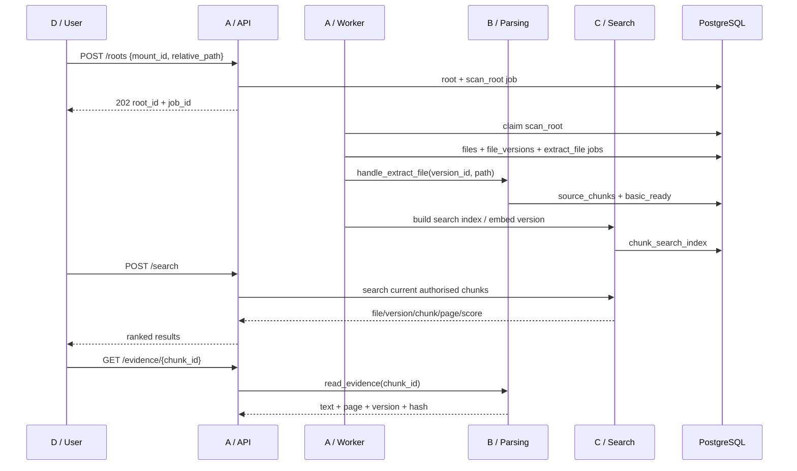

# Team 11 W7 Shared Integration Contract

Version: **v1.0 release candidate**

Date: 2026-10-17

Branches: `w7-scan-dispatch` (A), `w7-parsing` (B),
`feat/c-search-model-evaluation` (C), `Role_D` (D)

Architecture authority: `docs/architecture.md` on `week04-architecture-proposal`

This contract records the decisions the four members need before integration:
**a single definition for each shared table, search results that resolve to source
evidence, explicit asynchronous job states, and a common public API.** It describes
the required integration target, rather than claiming that any branch already
implements the entire system. The branch snapshots and outstanding work below are
historical observations from the date above.

## Execution overview

| Member | Required work |
| --- | --- |
| A | Merge B into the A+B integration branch; keep B's file/version/chunk tables; implement scanning, `current_version_id`, worker dispatch, and canonical routes; review C's incremental migration |
| B | Preserve chunk IDs and fields; provide parsing, evidence, and review handlers in A's integration branch; allow evidence reads for `paused` roots; avoid a second set of search tables |
| C | Replace its duplicate file/version/chunk definitions with the canonical models; add `chunk_search_index`; attach its migration to `445f908b73b4`; adapt `indexing.py`, `retrieval.py`, and tests |
| D | Consume the canonical flat root/job responses; call `POST /search` and `GET /evidence/{chunk_id}`; use the shared lowercase error codes |

A+B establish the common data model, C adds search indexes, and D connects the UI
to the public API.

## 0. Effective rules

The following are merge requirements. An incomplete item must not be described as
an integrated feature.

1. **Keep one set of file, version, and chunk tables.** B's `files`,
   `file_versions`, and `source_chunks` are the sole source of document text.
2. **C stores search-derived data.** Embeddings, normalized search text, and
   search terms belong in `chunk_search_index`. C must not create a second set
   of file, version, or chunk tables.
3. **All chunk references use `source_chunks.id`.** Search results, source
   evidence, relation evidence, and reviews must resolve through the same ID.
4. **Alembic must have one head.** Renaming migration files cannot resolve
   competing chains; `down_revision` must point to the actual predecessor.
5. **A owns final assembly of shared files.** A reviews and merges
   `services/common/`, `alembic/`, `services/api/app/main.py`, and worker dispatch.
   B/C provide field and behavior requirements without introducing competing
   definitions in their branches.
6. **Machine-readable values use lowercase snake_case.** IDs are UUID strings;
   timestamps use UTC. Persist the canonical states and error codes without
   translating them or substituting case variants or aliases.
7. **Errors remain distinct from empty results.** Missing files, superseded
   versions, revoked roots, degraded AI, and a valid search with no matches have
   different meanings.
8. **Source files are read-only.** The API, worker, search, and review paths must
   not move, rename, modify, or delete a user's original files.

When this contract changes, update this document and explain the change before
changing the code. Keep the implementation and contract consistent.

---

## 1. Branch snapshots and integration order

Remote states checked when this version was written:

| Member | Branch | Snapshot | Responsibility |
| --- | --- | --- | --- |
| A | `w7-scan-dispatch` | `7b084e5` | Authorization, scanning, jobs, mounts, shared models, route assembly |
| B | `w7-parsing` | `a91d521` | PDF parsing, chunks, evidence, relations, review |
| C | `feat/c-search-model-evaluation` | `482ac32` | English/CJK keyword search, embeddings, hybrid retrieval, evaluation |
| D | `Role_D` | `eb656ca` | Folder selection, progress, results, evidence, review UI |

### 1.1 Integration direction

```text
starter main
    +-- A: scan / jobs / mounts
    +-- B: parsing / evidence / review
             |
      A+B integration branch
             |
      C adapted to canonical schema
             |
      D connected to canonical API
             |
         team main
```

1. A merges B into A's integration branch. The checked snapshots merged without
   conflicts.
2. C merges A+B, removes its three duplicate table definitions, and adapts
   retrieval to the canonical schema.
3. D connects the real API. Mock responses and browser-side filtering do not
   establish that backend search is integrated.
4. Merge the integration branch into `main` only after the complete integrated
   workflow passes its tests.

Do not retain C's `20261015_0002_source_search` alongside B's independent
`c2d1ac693a0e -> 318ab5be35e0 -> 445f908b73b4` chain without adapting the migration.
Both chains branch from the starter and attempt to create `source_chunks`.

---

## 2. Canonical data model

### 2.1 Authoritative tables

| Meaning | Table | SQLAlchemy model | Owner |
| --- | --- | --- | --- |
| Authorized directory | `authorized_roots` | `AuthorizedRoot` | A |
| File location and current version pointer | `files` | `FileRecord` | A |
| Immutable content version | `file_versions` | `FileVersion` | A |
| Source passage with page location | `source_chunks` | `SourceChunk` | A/B boundary; B produces it |
| Asynchronous task | `jobs` | `Job` | A |
| Entity candidate | `entities` | `Entity` | A reviews; B produces it |
| Relation candidate | `relationships` | `Relationship` | A reviews; B produces it |
| Relation evidence | `relationship_evidence` | `RelationshipEvidence` | A reviews; B produces it |
| Human review history | `reviews` | `Review` | A reviews; B produces it |
| Search-derived data | `chunk_search_index` | `ChunkSearchIndex` | A reviews; C produces it |

Remove these duplicate C definitions during integration:

- `source_files`
- `source_versions`
- C's separate definition of `source_chunks`

C retains its search implementation. The replacement concerns the persistence
schema copied for the standalone demonstration. Retained components include:

- English/CJK normalization, tokenization, and query limits;
- the embedding HTTP client, local E5 model, and vector validation;
- keyword, semantic, and hybrid ranking and degradation behavior;
- the AI `/embeddings` endpoint;
- evaluation fixtures, gold queries, quality records, and evaluation scripts;
- `chunk_search_index` and its indexing, vector, degradation, and evaluation tests.

The main production adaptations are in `services/search/indexing.py` and
`services/search/retrieval.py`, which access the old model names directly. The
other search components can be reused. Preserve behavioral test assertions while
adapting fixtures and the affected response fields to the canonical schema.

### 2.2 Field semantics

#### `files`

- `id`: a stable file ID across content versions.
- `root_id`: references an authorized directory.
- `current_version_id`: points to the latest version observed by scanning;
  maintained by A's scan transaction.
- `relative_path`: relative to the authorized directory; never a host absolute path.
- `name`: display filename.
- `presence_status`: `present`, `missing`, or `unavailable`.

Rules:

- When new content appears, create or reuse `FileVersion` and update
  `current_version_id` in the **scan transaction**.
- Retain the historical pointer when a file disappears, but exclude files with
  `presence_status != present` from normal search and current evidence responses.
- Repeated scans of the same path and SHA-256 must not duplicate versions or jobs.
- Identical content at different paths remains two `files` records. Do not merge
  or delete file records based solely on their content hash.

#### `file_versions`

- `id`: immutable version ID.
- `file_id`: owning file.
- `content_sha256`: SHA-256 of the bytes actually read for this version.
- `byte_size`: content length in bytes.
- `status`: version processing state.
- `parser_revision`: parser revision used to process the version.
- `error_code`: stable reason for failure or unsupported content.
- Unique constraint: `(file_id, content_sha256)`.

#### `source_chunks`

- `id`: stable chunk ID shared by document text, search, evidence, and relations.
- `version_id`: references `file_versions.id`, without a second `source_version_id`.
- `ordinal`: contiguous, unique within the version, and starts at 1.
- `page_number`: 1-based PDF page number. A chunk never spans pages.
- `text`: cleaned source passage, without search-specific rewriting.
- Unique constraint: `(version_id, ordinal)`.

When reprocessing the same version:

- Preserve a chunk's `id` when its text and page location are unchanged.
- Replace chunks whose text changes. Search indexes and relation evidence tied
  to the old chunks may be removed through cascading foreign keys.
- Do not unconditionally delete and recreate all chunks; human reviews and search
  indexes require stable references.

### 2.3 Search-derived table: `chunk_search_index`

Suggested DDL semantics:

```text
chunk_search_index
  chunk_id             VARCHAR(36) PRIMARY KEY
                       FOREIGN KEY source_chunks.id ON DELETE CASCADE
  search_text          TEXT NOT NULL
  search_terms         TEXT NOT NULL
  embedding            vector(384) NULL       -- JSON variant for SQLite tests
  embedding_model      VARCHAR(120) NULL
  embedding_dimensions INTEGER NULL
  created_at           TIMESTAMPTZ NOT NULL
  updated_at           TIMESTAMPTZ NOT NULL
```

Additional PostgreSQL index:

```sql
CREATE INDEX ix_chunk_search_index_keyword
ON chunk_search_index
USING gin (to_tsvector('simple', search_terms));
```

Rules:

- `chunk_id` maps one-to-one to `source_chunks.id`.
- `search_text/search_terms` are derived values and do not replace source text.
- Generate keyword fields even when AI is unavailable. Keyword search must not
  depend on successful embeddings.
- Embedding failures affect semantic/hybrid retrieval without deleting source
  text or keyword indexes.
- Replacing a chunk deletes its index through `ON DELETE CASCADE`; the worker
  must rebuild the index for the replacement.
- Bulk SQL may bypass `normalize_text()` and `search_terms()` only if it explicitly
  produces exactly the same values.

### 2.4 Mapping from C's fields

| Original C field | Canonical field |
| --- | --- |
| `SourceFile.id` / `source_files.id` | `FileRecord.id` / `files.id` |
| `SourceFile.name` | `FileRecord.name` |
| `SourceFile.path` | `FileRecord.relative_path` |
| `SourceVersion.id` | `FileVersion.id` |
| `SourceVersion.source_file_id` | `FileVersion.file_id` |
| `SourceVersion.sha256` | `FileVersion.content_sha256` |
| `SourceVersion.is_current` | `FileRecord.current_version_id == FileVersion.id` |
| `SourceChunk.id` | `SourceChunk.id`, preserving the same ID |
| `SourceChunk.source_version_id` | `SourceChunk.version_id` |
| `SourceChunk.chunk_index` | `SourceChunk.ordinal` |
| `SourceChunk.page_start/page_end` | `SourceChunk.page_number`; one `page` field in responses |
| `SourceChunk.search_text/search_terms` | `ChunkSearchIndex.search_text/search_terms` |
| `SourceChunk.embedding` | `ChunkSearchIndex.embedding` |

The canonical schema has no `version_number` equivalent. C/D must not invent a
temporary sequence number. Search responses use stable `version_id`; use
`version_created_at` when a display timestamp is needed.

---

## 3. States and job contract

### 3.1 State vocabulary

#### Root: `AuthorizedRoot.status`

- `active`: scanning, search, and evidence reads are allowed.
- `paused`: no new jobs; existing content remains searchable and readable.
- `revoking`: only cleanup jobs are allowed.
- `revoked`: immediately excluded from search and evidence reads.

#### File: `FileRecord.presence_status`

- `present`
- `missing`
- `unavailable`

#### Version: `FileVersion.status`

```text
discovered -> extracting -> basic_ready -> enriched
                           +-----------> failed
                           +-----------> unsupported
```

- `basic_ready`: source text and chunks are stored; keyword search is available.
- `enriched`: additional analysis or vectors are complete; this state must not be
  a prerequisite for keyword search.
- `failed`: processing failed with an `error_code`; retries follow the job policy.
- `unsupported`: content or format cannot be processed; this is a handled outcome.

Every version entering `extracting` needs a terminal outcome. A failure while
reading, chunking, writing data, or committing the final status must record
`failed`; the version must not remain in `extracting` indefinitely.

### 3.2 Job states

The database and worker use:

- `pending`
- `claimed`
- `completed`
- `failed`

The public API exposes:

- `pending`
- `running`, mapped from database `claimed`
- `completed`
- `failed`

`retry_wait` and `canceled` are future extensions. The API must not expose them as
supported states before their behavior is implemented.

### 3.3 Job types

| `job_type` | Required target | Owner |
| --- | --- | --- |
| `triage_case` | `case_id` | starter/A |
| `scan_root` | `root_id` | A |
| `extract_file` | `version_id` | A dispatches; B handles |
| `embed_file` | `version_id` | A dispatches; C handles |

Every job has exactly one valid target. `extract_file` must not enter the starter
Case path. A failed `embed_file` job must not delete parsed source text.

### 3.4 Job transactions

1. Scanning creates `files`, `file_versions`, and `extract_file` jobs in one
   transaction.
2. B's `handle_extract_file()` stores chunks and the version result.
3. A creates or continues search-index jobs only after source text is stored
   successfully.
4. C prepares keyword indexes before attempting embeddings.
5. An embedding failure may fail its job while leaving version text available;
   search degrades to keyword mode.
6. Repeated scans and repeated jobs must be idempotent.

---

## 4. Mount and path contract

1. `mount_id` must come from the server allowlist:

```text
source_mounts: {mount_id: container_path}
```

2. The UI sends `mount_id + relative_path`, without host absolute paths.
3. `relative_path` must be relative, contain no `..`, remain within the mount and
   authorized root after canonicalization, and reject symlink escapes.
4. The API and worker use the same read-only mount. A read-only mount complements
   path authorization and does not replace it.
5. Scanning must not silently discard files based on extension. The parser marks
   unprocessable content as `unsupported` with a specific `error_code`.

---

## 5. Complete data flow



Create canonical chunks before search indexes. Every search result must resolve
to evidence for the same chunk.

---

## 6. Public API contract

### 6.1 Common rules

- Successful resource IDs are nonempty UUID strings.
- JSON fields use snake_case.
- Collections are arrays, without an undeclared `items` wrapper.
- Timestamps use ISO 8601 UTC.
- Paths expose authorized `relative_path` values, without host absolute paths.
- Errors use this common shape:

```json
{
  "detail": {
    "code": "version_superseded",
    "message": "The file has newer content; this passage is historical"
  }
}
```

- Machine-readable codes stay lowercase snake_case; D maps them to display text.

### 6.2 Mounts and scanning

#### `GET /mounts`

Response:

```json
[
  {
    "mount_id": "corpus",
    "label": "Course corpus",
    "read_only": true,
    "availability": "available"
  }
]
```

#### `GET /mounts/{mount_id}/directories`

Returns selectable relative directories under the mount:

```json
[
  {"relative_path": ".", "label": "Course corpus"},
  {"relative_path": "week5", "label": "week5"}
]
```

Unknown mounts return `404 unknown_mount`; out-of-scope paths return
`403 path_out_of_scope`.

#### `POST /roots`

Request:

```json
{"mount_id": "corpus", "relative_path": "week5"}
```

Successful response: **HTTP 202**.

```json
{
  "root_id": "uuid",
  "job_id": 17,
  "status": "pending"
}
```

An active scan for the same path returns `409 active_job_exists`, including the
existing `root_id/job_id`. During route assembly, replace B's nested `{root, job}`
response with this flat shape, or update D's adapter to the agreed alternative at
the same time. The final integration must use one consistent shape.

#### `GET /roots/{root_id}`

```json
{
  "root_id": "uuid",
  "status": "active",
  "availability": "available",
  "file_counts": {
    "total": 16,
    "discovered": 0,
    "extracting": 0,
    "basic_ready": 12,
    "enriched": 0,
    "failed": 3,
    "unsupported": 1
  }
}
```

Counts describe mutually exclusive stages of current versions. Do not count
historical versions again.

#### `GET /roots`

Returns an array of objects with the same shape as `GET /roots/{root_id}`, allowing
the UI to restore authorized directories when reopened. Return only roots that
have not been revoked; historical roots require an explicit history query.

#### `POST /roots/{root_id}/scans`

Rescans an existing root and returns HTTP 202 with a new `job_id`. Initial
authorization and scanning remain atomic through `POST /roots`.

### 6.3 Jobs and files

#### `GET /jobs/{job_id}`

```json
{
  "job_id": 17,
  "job_type": "scan_root",
  "root_id": "uuid",
  "version_id": null,
  "status": "running",
  "attempts": 1,
  "error_code": null,
  "created_at": "2026-10-17T06:00:00Z",
  "completed_at": null
}
```

#### `GET /files?root_id={root_id}`

```json
[
  {
    "file_id": "uuid",
    "root_id": "uuid",
    "version_id": "uuid-or-null",
    "display_name": "Week 5.pdf",
    "relative_path": "week5/Week 5.pdf",
    "presence_status": "present",
    "status": "basic_ready",
    "error_code": null,
    "updated_at": "2026-10-17T06:00:00Z"
  }
]
```

`status` is the current version's `FileVersion.status`; use `discovered` when no
version exists. `expected_error_code`, `capability_status`, and `snippet` are not
canonical backend fields. D must derive any such presentation concepts from
existing fields rather than requiring invented backend data.

### 6.4 Search

#### `POST /search`

Request:

```json
{
  "query": "database backup",
  "mode": "hybrid",
  "top_k": 10,
  "root_id": "uuid-or-null",
  "file_id": "uuid-or-null"
}
```

- `mode`: `keyword | semantic | hybrid`.
- When AI is unavailable or embeddings are incomplete, return HTTP 200 with
  `degraded=true` and a `degradation_reason`.
- After normalization, `query` must be nonempty and contain at most 500 characters
  and 64 search tokens.
- When both `root_id` and `file_id` are supplied, apply their intersection.
  Filtering by `file_id` must not bypass root authorization.

Response:

```json
{
  "query": "database backup",
  "mode": "hybrid",
  "effective_mode": "keyword",
  "results": [
    {
      "root_id": "uuid",
      "file_id": "uuid",
      "file_name": "Week 5.pdf",
      "file_path": "week5/Week 5.pdf",
      "version_id": "uuid",
      "version_created_at": "2026-10-17T06:00:00Z",
      "chunk_id": "uuid",
      "ordinal": 8,
      "page": 6,
      "text": "bounded source excerpt",
      "reason": "keyword: database,backup",
      "score": 0.91,
      "keyword_score": 1.0,
      "semantic_score": 0.0
    }
  ],
  "total": 1,
  "degraded": true,
  "degradation_reason": "ai_unavailable",
  "candidate_count": 1,
  "candidate_limit": 200
}
```

Search reads only:

- roots with `active` or `paused` status;
- files with `presence_status=present`;
- versions referenced by `current_version_id`;
- versions in `basic_ready` or `enriched` state;
- chunks belonging to those current versions.

Every returned `chunk_id` must be usable directly with the evidence endpoint.

### 6.5 Evidence

#### `GET /evidence/{chunk_id}`

This is the canonical evidence endpoint. D must use the chunk-based contract
rather than the previous proposal to return all chunks for a file.

Successful response:

```json
{
  "chunk_id": "uuid",
  "file_id": "uuid",
  "version_id": "uuid",
  "relative_path": "week5/Week 5.pdf",
  "page_number": 6,
  "ordinal": 8,
  "text": "the exact stored passage",
  "content_sha256": "64 lowercase hex characters"
}
```

Refusal rules:

| `code` | HTTP | Meaning |
| --- | --- | --- |
| `chunk_not_found` | 404 | The chunk does not exist |
| `file_missing` | 404 | The file record or on-disk source is unavailable |
| `root_revoked` | 403 | The directory is being revoked or has been revoked |
| `version_superseded` | 409 | The chunk belongs to a historical version |
| `no_current_version` | 503 | Processing has not established the current version |

Relation evidence must belong to the relation's declared version. Offsets must
fall within the chunk text, and the quote must contain the corresponding entity
label. Read paths must repeat these checks; an existing foreign-key target alone
is insufficient proof of valid evidence.

### 6.6 Relations and review

#### `GET /versions/{version_id}/relations`

Returns at most 20 candidates. Each candidate must include:

```json
{
  "relationship_id": "uuid",
  "entity_type": "person",
  "label": "Chen",
  "relation_type": "mentions",
  "page_number": 3,
  "quote": "supported text",
  "evidence_missing": false,
  "decision": null,
  "decision_revision": 0,
  "corrected_entity_id": null
}
```

#### `POST /relations/{relationship_id}/reviews`

```json
{
  "decision": "corrected",
  "expected_revision": 0,
  "reason": "wrong entity",
  "actor": "reviewer-a",
  "corrected_entity_id": "uuid"
}
```

Rules:

- `confirmed/rejected` must not include `corrected_entity_id`.
- `corrected` requires an existing entity ID.
- A mismatched `expected_revision` returns `409 review_conflict`.
- Append a new row for every decision; preserve review history.

---

## 7. Migration contract

### 7.1 Single migration chain

Keep B's existing chain:

```text
20260713_0001
  -> c2d1ac693a0e
  -> 318ab5be35e0
  -> 445f908b73b4
  -> C: add chunk_search_index
```

C's incremental migration must use:

```python
revision = "20261017_0003"
down_revision = "445f908b73b4"
```

It creates only:

- the `vector` extension on PostgreSQL;
- `chunk_search_index`;
- the corresponding foreign keys and GIN index.

It must not create `source_files`, `source_versions`, or `source_chunks` again.

### 7.2 Migration acceptance

```cmd
python -m alembic heads
python -m alembic upgrade head
python -m alembic downgrade 20260713_0001
python -m alembic upgrade head
```

`alembic heads` must report exactly one head. An empty database upgrade, full
downgrade, and subsequent upgrade must all succeed.

Local databases that ran C's old migration contain unmerged test data. Validate
with a fresh empty test database instead of manually dropping tables in a shared
team database.

### 7.3 Compose and dependencies

The integrated `compose.yaml` must retain:

- A's read-only source mount;
- A's PostgreSQL host-port policy;
- C's `pgvector/pgvector:pg16` image;
- the read-only AI model directory mount;
- C's `pgvector` and embedding dependencies.

Combine these requirements when resolving Compose changes. Rebuild after changes
to dependencies or migrations:

```cmd
docker compose build api
docker compose up -d
```

---

## 8. Required work by member

### A: shared models, migrations, jobs, and routes

1. Merge B into A+B and establish B's canonical tables as the only shared models.
2. Implement the scan transaction: reuse unchanged content, create new versions,
   atomically update `files.current_version_id`, and create `extract_file` jobs.
3. Implement path resolution with a mount allowlist, canonical containment, and
   rejection of symlink escapes.
4. Dispatch `scan_root`; call B for `extract_file`; schedule C's search indexing
   and embeddings after source text is stored successfully.
5. Assemble mount, directory, root, file, and job routes; B's evidence, relation,
   and review routes; and C's `/search` route.
6. Own the final Alembic files. C's migration draft must follow `445f908b73b4`.
7. Map database `claimed` to public API `running` consistently.

### B: parsing, evidence, relations, and review

1. Preserve `files/file_versions/source_chunks` fields and stable chunk IDs.
2. Keep C's search fields outside the parsing tables; store embeddings in
   `chunk_search_index`.
3. Retain the established outcome states and reason codes.
4. Allow `read_evidence()` for both `active` and `paused` roots. Only
   `revoking/revoked` should produce `root_revoked`. The implementation checked
   when this document was written allowed only `active`; fix this during
   integration.
5. Preserve these handler entry points for A:

```text
handle_extract_file(db, version_id, source_path)
read_evidence(db, chunk_id)
read_relationships(db, version_id)
record_review(...)
```

6. Propose shared-schema changes to A before introducing a change; avoid a new
   table with equivalent semantics.

### C: retrieval and vectors

1. Remove C's duplicate `SourceFile/SourceVersion/SourceChunk` definitions while
   retaining the algorithms in `services/search/`.
2. Adapt `indexing.py` to B's `FileVersion/SourceChunk`. Keep `index_document()` as
   a test/import adapter; the production path starts from B's parsed output.
3. Adapt `retrieval.py` to join B's files, versions, chunks, and authorized roots.
4. Add `ChunkSearchIndex` with a unique foreign key to `source_chunks.id`. Replace
   the old C `SourceChunk` insert/update listeners with explicit
   `prepare_keyword_index(version_id)` and `embed_version()` calls.
5. Replace response `version_number` with `version_created_at`.
6. Replace `page_start/page_end` with `page`; B's chunks never span pages.
7. Add `root_id` filtering; a `file_id` filter cannot substitute for authorization.
8. Create only `chunk_search_index` in the search migration, after `445f908b73b4`.
9. Preserve keyword fallback. AI failure must not remove parsed text.
10. Use canonical fixtures in C's tests instead of a second set of test-only
    file/version/chunk models.

### D: frontend consumption

1. Consume the canonical flat `POST /roots` response using one agreed shape.
2. Map public job `running` to the UI's running state.
3. Use version IDs and version status in the file list; derive display concepts
   without inventing `expected_error_code/capability_status` backend fields.
4. Call `POST /search` from the search box; browser-side filtering alone is
   insufficient to claim that backend search is complete.
5. Open search-result evidence through `GET /evidence/{chunk_id}`.
6. Use the shared lowercase snake_case error codes.
7. Call canonical relation/review routes. If unavailable, display that state
   instead of silently returning mock data.

---

## 9. Testing and acceptance gates

### 9.1 Minimum branch checks

- `ruff check .` passes.
- The branch's own tests pass.
- Tests run after rebuilding images without relying on a source bind mount.
- Report skipped tests and their reasons separately from passes.

### 9.2 Required integrated workflow

1. `alembic heads` reports one head.
2. An empty PostgreSQL database upgrades to head.
3. Mount and directory listing endpoints work.
4. `POST /roots` returns 202 and creates a root plus a pending scan job.
5. Worker scanning produces `files/file_versions/source_chunks`.
6. New content updates `current_version_id`; historical versions remain stored
   but are excluded from current search.
7. Extraction preserves chunk page numbers; a bad file does not block others.
8. Search works with keyword retrieval alone.
9. Semantic/hybrid retrieval works with the model available and explicitly
   degrades when AI is disconnected.
10. A search result's `chunk_id` retrieves the same passage from the evidence API.
11. Historical evidence returns 409; revoked-root evidence returns 403.
12. Relation evidence stays within the correct version and offsets; competing
    reviews return 409.
13. Repeated scans duplicate neither files, versions, chunks, nor active jobs.
14. Stored data remains readable after a service restart.
15. Original file SHA-256 values remain unchanged throughout the workflow.

### 9.3 Evidence for completion

Every completion claim must include:

```text
commit hash
executed command
actual output summary
database and image versions used
```

Code inspection and independent branch tests do not replace integrated
end-to-end results.

---

## 10. Change control

1. Update this document before changing shared fields, states, endpoints, or job
   semantics.
2. A reviews shared models and migrations; B/C provide tests and migration intent;
   D adapts at the API adapter boundary.
3. Do not use `_a/_b/_c.py`, `table_b/table_c`, or parallel API prefixes as a
   permanent workaround for conflicting meanings of a shared model or endpoint.
   Suffixes are appropriate only for independent implementations.
4. After resolving conflicts, rerun both branches' original tests and the added
   integration tests.
5. Request integration into `main` only after the checks in section 9 pass.

## 11. Outside this contract

- Moving, renaming, or deleting files, and undoing those operations.
- OCR extensions.
- DOCX, TXT, and image parsing extensions.
- Cloud models or remote fallback.
- Complete knowledge-graph visualization.
- Multi-user identity and remote authentication.

Future extensions must preserve chunk IDs, current-version semantics,
authorization, and error meanings established here.

---

## 12. Revision 2026-10-29: unreadable files, retryable failures, authorization time

Additive changes owned by A. Nothing here renames or removes an existing field,
state, or endpoint; existing clients keep working.

### 12.1 `files.presence_reason` (new, nullable)

| Column | Type | Meaning |
| --- | --- | --- |
| `files.presence_reason` | `VARCHAR(100)` NULL | Why the last scan could not read the file |

Values, all lowercase snake_case:

- `file_missing`: the path was discovered and then could not be opened.
- `unreadable`: the path exists but its bytes could not be read (permission or
  I/O error).
- `not_a_regular_file`: a socket, FIFO or device; there are no bytes to version.

`presence_status` still carries the coarse answer (`missing` / `unavailable`),
and `presence_reason` explains it. `NULL` means the last scan read the content.

`GET /files` now returns `presence_reason` alongside `presence_status`. A file
the scan has never read has `version_id: null`, `status: "discovered"`, and a
reason - it is a record, not an omission. `last_seen_at` keeps the last scan
that actually read the bytes, so it is not refreshed by a failed read.

Scanning rules that follow from this:

- A file that cannot be read is recorded, never skipped silently.
- An existing row must not keep `presence_status = present` after a failed read.
- One unreadable file, or one unlistable directory, does not stop the scan.
  Unlistable directories are reported in the scan summary
  (`directories_unreadable`, `unreadable_directories`) because they have no
  file record to hang a reason on.

### 12.2 `jobs.error_code` (new, nullable)

`jobs.error_code` is the stable reason the last attempt failed. `GET /jobs/{id}`
returns it instead of the generic `job_failed` when it is set; `job_failed`
remains the fallback for failures that have no recorded reason. `jobs.error`
stays a diagnostic string and is still never exposed.

### 12.3 Handler outcome to job status (A2)

`handle_extract_file()` returns the version's terminal status. The worker maps
it as follows, and this mapping is normative:

| Version outcome | Job status | Notes |
| --- | --- | --- |
| `basic_ready` | `completed` | The `embed_file` job is queued in the same transaction |
| `enriched` | `completed` | Same |
| `unsupported` | `completed` | Handled document outcome; job `error_code` copies the version reason |
| `failed` | `failed` | Job `error_code` copies the version reason; the job is retryable |
| anything else | job fails with an internal error | A version left mid-pipeline must not be reported as finished |

Consequences:

- A `failed` version is always paired with a `failed` job, so
  `POST /jobs/{job_id}/retry` accepts it. `attempts` is never reset.
- `POST /jobs/{job_id}/retry` clears `error`, `error_code`, `claimed_at` and
  `completed_at`, and keeps `attempts` as provenance.
- A retry of an extract job whose version already holds `basic_ready` or
  `enriched` closes the job without re-parsing: re-parsing would replace chunk
  rows and detach the reviews and search indexes that reference their ids.
- A **scan is not an implicit retry**. Scanning re-dispatches only `discovered`
  versions that have no live job. Recovering a `failed` version is an explicit
  `POST /jobs/{job_id}/retry`, so a permanently broken file cannot generate one
  new job per scan.
- Because recovery never changes the content hash, the rescanned file reuses its
  version row: no new file, version, chunk, or job.

### 12.4 Authorization-time containment (A3)

`POST /roots` performs the canonical containment check **before** writing a
root or a job:

1. `mount_id` must be in the allowlist -> otherwise `404 unknown_mount`.
2. `relative_path` must be relative and free of `..` ->
   otherwise `403 path_out_of_scope`.
3. The path is resolved (symlinks and Windows junctions collapsed) and must
   stay inside the mount -> otherwise `403 path_out_of_scope`.
4. The resolved path must be a directory -> otherwise `404 source_unavailable`.

A refused request leaves no `authorized_roots` row and no job. The worker repeats
the same check before extraction, so a path cannot become valid by being recorded
first. Directory junctions are treated as links by the scan walk as well, because
`is_symlink()` reports a junction as an ordinary directory.

