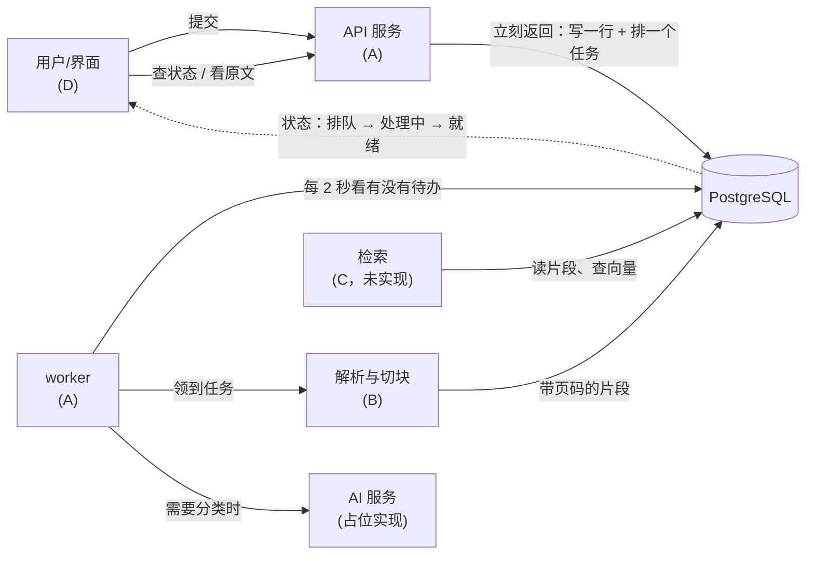
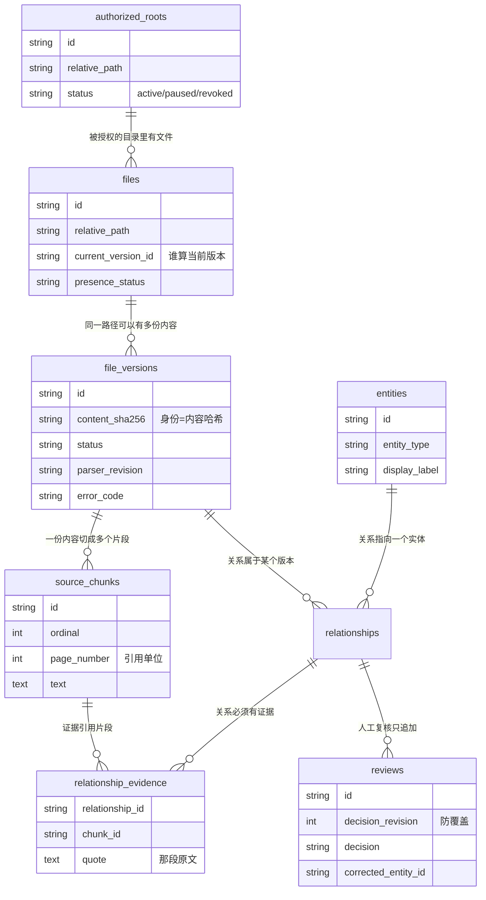
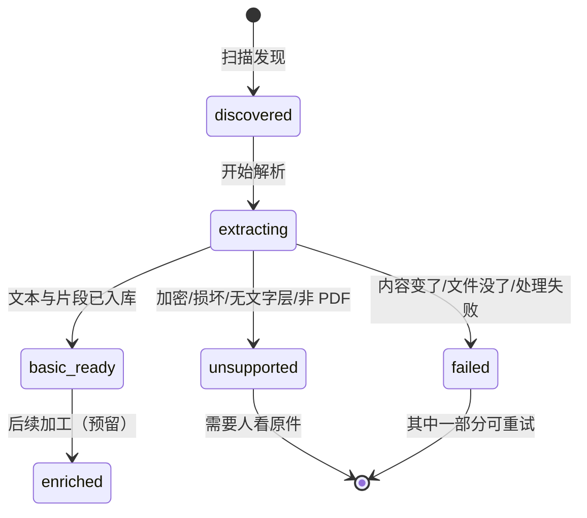
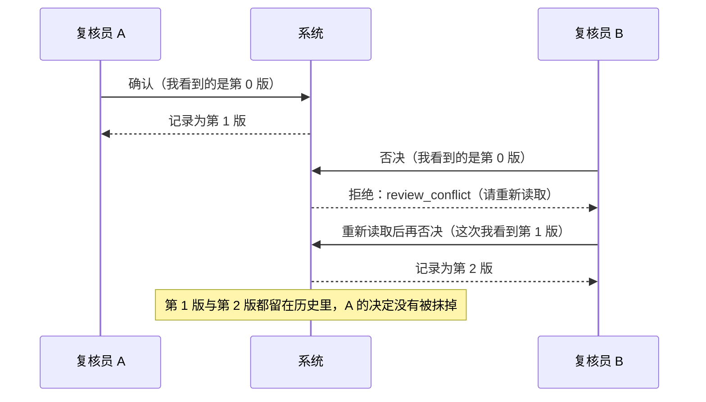

# 技术决策报告：每个关键选择、它的替代方案、以及行业里的常见做法

*English note: a Chinese-language report written for the team member who owns
the read-files slice. For each technical decision in this system it records
what was chosen, why, what else could have been done, the trade-offs, and what
the wider industry does. Code paths are named so a reader can check any claim.*

---

## 0. 这份报告怎么读

系统不是"用了一堆技术"，而是**做了一连串取舍**。每一个取舍都可以换成别的做法，而
换法的代价是不一样的。下面每一节都是同一个结构：

1. **我们怎么做**（并指出代码在哪）
2. **为什么这么做**
3. **其他可行做法**（每种都写清代价）
4. **行业里现在通常怎么做**
5. **这个选择的代价**（诚实写出来，不藏）

最后有一张总表，可以只看那张。

---

## 0.5 先看图：系统的形状

文字之前先看四张图。**看图时只注意一件事**：数据从哪里进、在哪里停、谁能改它。

（这几张图是 mermaid 源码：在 GitHub 上、以及任何支持 mermaid 的编辑器里会自动
渲染成图；在纯文本里看到的是源码。四张图都用 mermaid 的解析器验过语法——写这份
报告时专门装了解析器，因为"图画错了渲染不出来"正是我一直在抓的那类问题。）

### 图 1：一次上传要经过什么（括号里是负责人）

**要看出**：慢的事情（解析、模型）全都发生在右边，**用户请求里只写一行数据、排一个任务**。
所以网页不会转圈，失败也能重试。

### 图 2：数据长什么样（表与关系）

**要看出**三件事：`file_versions.content_sha256` 是版本的身份；`relationship_evidence`
把"结论"和"原文"钉在一起；`reviews.decision_revision` 是防止两个人互相覆盖的机关。

### 图 3：一份文件的结局只有这几种

**要看出**：`unsupported` 与 `failed` 是**两种不同的结局**——前者"我们看不懂这种文档"，
后者"这次没成功，但可以再试"。界面据此决定给用户看什么按钮。

### 图 4：两个人同时复核时会发生什么

**要看出**：系统**宁可让人看到一次冲突**，也不让人以为自己保存成功——这是"人工决定
不可再生"的直接后果。

---

## 1. 为什么 AI 处理放在后台 worker，而不是放在用户请求里

**我们怎么做。** 用户提交东西时，API 只做三件事：校验、写一行数据库、**写一个
job**，然后立刻返回。真正慢的处理由 worker 轮询 `jobs` 表领走
（`services/worker/app/main.py`），处理完把状态写回。前端看到的是一条状态从
`queued` → `triaged`（或失败原因）的记录。

**为什么。** 三个理由，按重要性排：

- **延迟**：解析一份 100 页 PDF 要几百毫秒到几秒，调模型可能几秒到几十秒。放在
  请求里，用户就盯着一个转圈页面，超时了就整个失败。
- **失败可重试**：后台任务失败了可以重试、可以记录第几次尝试。请求里的失败只能
  让用户再点一次。
- **资源隔离**：慢任务突发时会拖垮 API，而后台任务可以限速、可以只跑一个。

**其他可行做法。**

| 做法 | 优点 | 缺点 |
|---|---|---|
| 同步在请求里做 | 实现最简单，代码最少 | 慢、会超时、失败不可重试、无法限速 |
| 用 Celery / RQ / Dramatiq 这类任务队列 | 成熟、有重试与监控、支持优先级 | 多一个中间件（Redis/RabbitMQ）要部署运维；对课程规模来说是**额外的故障面** |
| 用云队列（SQS / Cloud Tasks） | 免运维、可弹性 | 绑定云厂商；本地开发要联网；课程要求本地可复现 |
| 直接把 job 写进数据库，worker 轮询（**我们的做法**） | 少一个组件；事务与业务数据同库；本地一条命令就能起 | 轮询有延迟（我们设 2 秒）；高并发下数据库会成瓶颈；没有优先级、没有重试退避策略 |
| 数据库 + `LISTEN/NOTIFY` | 有任务立刻唤醒，不用轮询 | 连接管理复杂；通知会丢，仍需轮询兜底 |

**行业里的常见做法。** 生产系统绝大多数用"队列 + worker"：中小规模常用 Celery /
Sidekiq / BullMQ 这类基于 Redis 的队列，大规模或云上用 SQS、Kafka、Cloud Tasks。
**用数据库当队列**在中小规模和"要尽量少依赖"的场景里也很常见（PostgreSQL 的
`SKIP LOCKED` 就是为这个设计的），本课程 starter 选的就是这条路。

顺带一个我们**没做**、但生产上会做的点：`claim_next_pending_job`
（`services/worker/app/main.py`）是"先 SELECT 再 UPDATE"，两个 worker 同时抢可能
抢到同一条。生产写法是 `SELECT ... FOR UPDATE SKIP LOCKED`，让每个 worker 各拿
一条。课程里只有一个 worker，所以没改，但这是**真实的扩展性缺口**。

---

## 2. 为什么文件版本用"内容哈希"来标识

**我们怎么做。** 表结构是 `authorized_roots` → `files` → `file_versions` →
`source_chunks`（`services/common/models.py`）。每个 `file_version` 带
`content_sha256`：**这份版本的身份就是它字节的哈希**。读取文件时重算哈希，与版本
记录不一致就拒绝发布（`services/parsing/pdf.py`、`handler.py`）。

**为什么。**

- 同一条路径下的文件可以**被改**，但"某一段文字来自哪些字节"必须永远可回答。哈希
  是唯一能直接回答这件事的标识。
- 重放/重试是安全的：解析同一份字节两次，结果必须一样。用时间戳标识就做不到。
- 证据的"过期"定义变得很清楚：**字节变了，旧证据就不是当前内容**。

**其他可行做法。**

| 做法 | 优点 | 缺点 |
|---|---|---|
| 自增版本号（v1、v2…） | 直观、短、数据库友好 | 只有"先后"，没有"是不是同一份内容"；跨机器/跨库对不上 |
| 用 mtime + 文件大小 | 不用读文件，极快 | 文件被改回原样、或 mtime 被保留时会误判；这是**经典的假阳性来源** |
| 只存路径 | 最省事 | 完全无法回答"这条证据来自哪一版"，也检测不到中途被改 |
| 内容哈希（**我们的做法**） | 可复现、可校验、天然去重、跨系统可比 | 必须整份读一遍（大文件慢）；哈希相同意味着"字节相同"，而**字节相同不等于解析结果相同**——换了库/换了版本，同一份字节的结果可能不同，所以还要记录解析器版本 |
| 哈希 + 文件路径 + mtime 一起存 | 排查问题时信息更全 | 多几个字段而已，成本很低；生产上通常会顺手存 |

**行业里的常见做法。** 这就是 **content-addressable storage**：Git 用对象的
SHA 标识内容，S3 有版本号 + ETag，Docker 用镜像摘要，包管理器（npm/pip）用哈希
校验下载。备份与同步工具（rsync --checksum、restic、borg）也是这个思路。
我们额外做了两件事，值得说：**把解析器版本也记在版本行上**
（`parser_revision`），以及**用两次哈希把"读取过程中被改"也盖住**——后者是独立
审查指出后才补的（见 `submissions/week07/B-fixes.md`）。

---

## 3. 为什么用 pypdf，以及为什么还要第二个库

**我们怎么做。** 抽取用 `pypdf`（纯 Python，`services/parsing/pdf.py`），把每页
文本按页装进 `ExtractedDocument`。**校验**用另一个库 PyMuPDF 独立重抽一遍，去
找我们存下来的片段（`scripts/verify_page_attribution.py`）。

**为什么两套。** 用自己的代码检查自己的输出等于什么都没证明——这正是这门课反复
强调的。所以判官必须换一个实现。

**其他可行做法。**

| 做法 | 优点 | 缺点 |
|---|---|---|
| pypdf（纯 Python，**我们的做法**） | 纯 Python，无系统依赖，容器里 `pip install` 就有；许可证宽松 | 版面信息弱；**字体编码缺映射时会把符号读成控制码**（我们在真实语料上确实遇到了）；对扫描件无能为力 |
| PyMuPDF (fitz) | 快、版面/坐标信息全、能渲染页面（我们的证据卡就是用它渲染的） | 是二进制扩展，许可为 AGPL/商业双授权（**AGPL 对闭源产品是个法律风险**，课程内部使用没问题） |
| pdfplumber / pdfminer.six | 版面与字符位置细致，适合表格 | 更慢；表格依旧要自己重建 |
| OCR（Tesseract / PaddleOCR / 云 OCR） | 唯一能处理扫描件的路 | 慢、贵；有识别错误，需要置信度与人工复核；中文/公式效果差异大 |
| 商业文档 AI（AWS Textract、Google Document AI、Azure Form Recognizer） | 表格/表单/手写识别成熟，带置信度 | 要联网、按页付费、数据出境问题；课程要求"本地可跑、不依赖云端" |
| Unstructured.io 这类统一解析层 | 一次接入多种格式 | 又一层依赖；出问题时更难定位 |

**行业里的常见做法。** 两条主流：**（1）能拿到文字层就用轻量解析库，拿不到才 OCR**
（先判断"有没有文字层"，我们也是这么做的：没有文字层直接判 `no_text_layer`）；
**（2）用两个独立引擎交叉校验关键字段**，这在金融/医疗文档流水线里很常见，因为
OCR/解析错误会直接变成业务错误。近两年又多了第三条：**用 LLM 做结构化抽取**，但
通常仍保留确定性解析作为"拿原文"的那一步。

**这个选择的代价（诚实）。** 我们遇到的：某两份别的课程的 PDF 里，根号与大括号
所在字体的编码**没有 Unicode 映射**，读出来是控制字符 0x10/0x11/0x00/0x01；
装 `fontTools` 也修不了。我们的处理是**把读不出的位置标成 U+FFFD**，而不是让它
悄悄消失（`services/parsing/chunking.py`）。另外版面信息基本丢失：表格里文字顺序
会乱，跨行标题会保留为多行——都写进了限制清单。

---

## 4. 切块：为什么 700 字符 / 120 重叠 / 绝不跨页

**我们怎么做。** 每页先清洗（`clean_page_text`），再切成 700 字符、相邻重叠 120
字符的片段，**片段绝不跨页**（`services/parsing/chunking.py`）。实测最长片段
699/639/692，实测重叠 118/119/119（比配置少一两个字符，因为存下来的片段会去掉
首尾空白）。

**为什么。**

- **不跨页**是因为引用单位是页：客户看到"第 7 页"，那这一段的每个字都必须真的来自
  第 7 页。跨页会让页码变成"大概在这两页之间"，引用价值归零。
- **重叠**是为了防止一句话正好被切在边界：至少有一块是完整的。
- **700 字符**大致是一屏能读完、且不超出常见 embedding 模型输入的长度。

**其他可行做法。**

| 做法 | 优点 | 缺点 |
|---|---|---|
| 固定长度 + 重叠（**我们的做法**） | 简单、可预测、可复现、切块数量可控 | 会在语义中间切断；对表格/代码块不友好 |
| 按句/段落切 | 语义更完整 | 段落长度极不均匀，可能超过模型上限；对幻灯片这种"一句话一行"的文本效果差 |
| 递归切分（LangChain `RecursiveCharacterTextSplitter` 等） | 兼顾结构（先段落、再句子），是当前最常见默认 | 参数多；结果依赖分隔符假设；换库就可能变 |
| 语义切块（用 embedding 判断话题切换） | 检索质量通常最好 | 慢、贵、**结果不可复现**（模型变则切块变），证据链难固定 |
| 按版面/表格结构切（需要 PyMuPDF/Document AI 级别的信息） | 表格、多栏文档效果最好 | 工程量大；我们这一版明确不做 |
| 整页一块 | 页码天然正确、最简单 | 一块可能几百字到几千字，检索粒度太粗，结果列表里塞整页 |

**行业里的常见做法。** RAG（检索增强生成）系统里，**递归切分 + 10–20% 重叠**目前
是最普遍的默认值，token 数常在 256–1000 之间；越来越多人用"小块检索、大块喂给
模型"（small-to-big / parent-document retrieval），也有用语义切块的。
**"不跨页"这件事在学术 RAG 里不常见，但在需要引用页码的文档系统里是硬要求**——
这也是我们和通用 RAG 教程最大的区别。

**这个选择的代价。** 一句话可能被切成两半（靠重叠兜住，但仍可能出现两块都不是
完整语义）；短页会产出很短的片段；另外我们实测到一条值得记住的边界：**如果一份
文档每一页只有同一行内容，页眉规则会把它全清掉**——现在规则被限制成"不允许把页面
清空"，并加了测试（`tests/unit/test_parsing_chunking.py`）。

---

## 5. 证据怎么存：为什么"引文 + 页码"要跟关系一起落库

**我们怎么做。** 一条关系（"这份文档提到某项目"）**不能单独存在**：它必须带一条
证据行，写明**来自哪个片段、页码是多少、用哪句话**（`relationship_evidence` 表，
`services/parsing/persist.py`）。没有引文的关系，代码直接拒绝写入。

**为什么。**

- **不可核查的结论等于没有结论**。用户点开一条关系，必须能跳到原文；否则这只是
  一个"模型说的"。
- 这条约束是**数据结构层面的**，不是界面层的：界面忘了显示引文，数据本身仍然完整。

**其他可行做法。**

| 做法 | 优点 | 缺点 |
|---|---|---|
| 关系 + 引文 + 页码（**我们的做法**） | 可核查、可跳转、可审计 | 存储冗余（同一句话可能被多条关系引用）；依赖片段 id 稳定，所以改切块策略就要处理历史 |
| 只存片段 offset（字符区间） | 精确、省空间 | 换解析器/清洗规则后 offset 全失效；对用户不直观 |
| 存 PDF 坐标（bbox） | 能高亮到"页面上哪一块"，界面最直观 | 需要版面级解析库；跨行/跨栏要额外处理；不同解析库坐标不一致 |
| 只存页码 | 简单 | 无法定位到句，用户还得自己在整页里找 |
| 把整页原文当证据 | 实现最简单、永远"在" | 关系与引文的对应关系丢失，无法回答"是这句话吗" |

**行业里的常见做法。** 做 RAG 的产品普遍要求"**引用可回溯**"（citation /
grounding），有两种主流实现：**按 chunk 引用**（返回片段文本与序号）和**按页码 +
坐标引用**（PDF 阅读器里高亮，Adobe、Document AI 这类产品）。金融/法务/医疗这类
高合规场景几乎都要求后者。近两年"**答案必须带原文出处**"已经从加分项变成默认
预期——因为模型编得太像真的。

**这个选择的代价。** 引文是**快照**：我们同时存了 `quote`（那一段文字）和它指向的
片段 id。如果片段被替换（重新解析），数据库会级联删掉证据，关系就变成"没有引文"
——这时读取接口会明确标注 `evidence_missing`，而不是显示一个空引文（这是独立审查
推动的改动）。另外同一句话被多条关系引用时会重复存储，我们没有做去重。

---

## 6. 失败处理：为什么"坏文件不是异常"，以及为什么状态码要分得细

**我们怎么做。** 解析器对文档问题**不抛异常**，而是把结果记在版本行上：

| 情况 | 状态 | 理由码 | 可重试 |
|---|---|---|---|
| 正常 | `basic_ready` | — | — |
| 加密 / 损坏 / 无文字层 / 非 PDF | `unsupported` | `encrypted` … | 否 |
| 字节变了（读之前或读之中） | `failed` | `source_changed` | 重新扫描后 |
| 文件不见了 | `failed` | `file_missing` | 文件回来就能 |
| 处理过程本身失败（例如写库出错） | `failed` | `processing_failed` | 由 worker 决定 |

**为什么。**

- **一个坏文件不能中断整次扫描**。这是"批量处理"和"处理一个文件"的根本区别。
- **"读不了"和"文件没了"要给不同的后续动作**：前者要人去看文档，后者值得重试。
- **状态必须能收尾**。版本行在开始处理时就被写成 `extracting`；如果之后失败却
  留在这个状态，界面看到的是"还在处理"，与"已经失败"无法区分——这一条是独立
  审查抓出来的，现在任何失败都会先写结果再上抛。

**其他可行做法。**

| 做法 | 优点 | 缺点 |
|---|---|---|
| 记状态 + 理由码（**我们的做法**） | 可批量、可重试、界面能解释 | 状态机要维护；状态含义一旦模糊（比如超时也算 `failed`）就会误导 |
| 抛异常让整批失败 | 实现最简单 | 一个坏文件毁掉整次扫描；运维只能事后猜 |
| 只记成功/失败两态 | 简单 | 无法区分"重试有用"和"重试无用"，用户看到"失败"却不知道做什么 |
| 用异常类型区分，不落库 | 代码里 type-safe | 状态不在数据里，界面/统计都拿不到；重试逻辑要重新判断 |

**行业里的常见做法。** 批量处理的常规形态是"**逐条状态 + 可重试 + 死信队列**"
（AWS Step Functions、Kafka 的死信主题、Celery 的重试策略）。这里有个通用原则：
**区分"可重试失败"和"永久失败"**，并且把失败原因**结构化存下来**（错误码而非
自由文本），这样监控能聚合、界面能翻译成人话。

**这个选择的代价。** 状态与理由码变多，需要文档化（我们写在
`submissions/week07/handover-to-A.md` 里给 A 用）；另外**检测"读取过程中文件被改"
要读两次哈希**——第一版只检测"读之前的版本行不一致"，独立审查指出有个几十毫秒的
窗口能把新文字挂在旧哈希下，现在已经补上。

---

## 7. 人工复核：为什么是"只追加 + 版本号检查"，而不是覆盖写

**我们怎么做。** 复核决定**只追加**，每条带一个递增的 `decision_revision`；调用方
必须说明"我看到的是第几版"，如果已经被别人改过，写入被拒绝并返回
`review_conflict`（`services/parsing/graph.py`）。数据库上还有
`(relationship_id, decision_revision)` 的唯一约束兜底——因为"先读再写"的检查
挡不住真正同时到达的两个请求。

**为什么。** 人类决定是**不可再生**的数据：规则输出可以重算，人的判断丢掉就是丢了。
所以既不能覆盖，也不能因为并发丢了。

**其他可行做法。**

| 做法 | 优点 | 缺点 |
|---|---|---|
| 只追加 + 版本号（乐观并发，**我们的做法**） | 保留完整历史；冲突对用户可见；不需要长时间持锁 | 调用方要处理冲突（重新读取）；同一行会累积多条记录 |
| 直接覆盖最新决定 | 表最简单 | 历史消失；同时操作时一方被静默覆盖（最糟的失败方式） |
| 悲观锁（`SELECT ... FOR UPDATE`） | 冲突不会发生，逻辑简单 | 要持有事务/锁；用户界面得处理"锁被占"；跨请求复核（人看一会儿再点）根本不适用 |
| 事件溯源（把决定当事件流） | 审计最强，可以重建任意时点状态 | 复杂度高，查询要折叠事件；课程规模不划算 |
| 单字段 + 审计日志表 | 读取简单 | 主表与日志可能不一致；审计表通常没人认真写 |

**行业里的常见做法。** 需要留痕的系统（工单、财务、合规）基本都用**追加式记录 +
乐观并发**：Jira 的状态变更历史、Kubernetes 的 `resourceVersion`（写冲突返回 409）、
Elasticsearch 的 `_seq_no`、Git 的不可变提交，本质都是同一件事。
**"最后写入者获胜"**只在真正无关紧要的数据上可以接受。

**这个选择的代价。** 调用方必须"读—改—写"并处理 409；表会变长（我们没做归档）；
有并发时用户会看到一次冲突提示——这是**故意的**，我们宁可让人看到冲突，也不要让人
以为保存成功。

---

## 8. 关系抽取：为什么用规则，而不是模型

**我们怎么做。** 规则集：以"项目类词结尾"的短语判为项目，带称谓的判为人名，跨片段
重复出现的首字母大写的词判为话题；**每条都带页码与引文**；结果**限制在 10 条**
（`services/parsing/relations.py`）。实测：三份课件原始候选 47/44/36 条，加"跳过
行首词"后 39/38/33，排序后有界到 10；**大约四分之三是对的**——这个比例我们写进了
材料，而不是含糊带过。

**为什么。**

- 排期要的是"少量候选 + 可核查"，不是知识图谱。规则**确定、可解释、可复现**：同一
  份文档跑两次结果一样，能用一句话解释每一条为什么出现。
- **诚实**：用模型更容易"看起来厉害"，但准确率说不清、复现不了，也不符合课程
  "技术上诚实"的评分点。

**其他可行做法。**

| 做法 | 优点 | 缺点 |
|---|---|---|
| 规则（**我们的做法**） | 可复现、可解释、零成本、不联网 | 覆盖率低；跨语言/领域要重写；我们实测约 3/4 精确 |
| 统计 NER（spaCy / Stanford NER） | 成熟、快、可离线、带置信度 | 领域适配要标注数据；**领域词（项目名、内部系统名）往往识别不出来**；中文模型另装 |
| LLM 抽取 | 覆盖率高、能给理由、改提示就能改行为 | 不确定、**不可复现**（同输入可能不同输出）、有成本、要联网或本地跑模型；仍然需要人工复核 |
| 向量聚类发现主题 | 无需词典，发现长尾 | 结果不可解释；阈值难定；同样要人复核 |
| 混合：规则/统计先召回，LLM 只在低置信处补 | 兼顾覆盖与可控成本 | 工程复杂度最高；两条路径的结果要合并与去重 |

**行业里的常见做法。** 文档理解产品普遍是**"抽取 + 人工确认"**：模型给出
建议与置信度，人确认或改判，改判被记录下来（用来评估、有时用来微调模型）。
近两年 GraphRAG 这类做法流行起来，但它们的共同前提是**先把抽取质量与人的分工
说清楚**——否则图谱里的错误会被下一层放大。**把候选限定在少量、并明确"这是候选不是
结论"**，是我们在课程范围里能做出的最负责的版本。

**这个选择的代价。** 覆盖面窄（很多真实实体找不到），准确率只有约 3/4，且**依赖
语言与文档风格**（英语课件效果好，换成中文或扫描件基本要靠重写规则）。

---

## 9. 测试策略：为什么"测试库与生产库不一样"是个陷阱

**我们怎么做。** 单元与集成测试跑在 **SQLite**（`tests/conftest.py`），因为它快
且不需要服务；**CI 里另外对着真实 PostgreSQL 跑迁移**（`.github/workflows/ci.yml`）。
最近把 SQLite 的**外键开关打开**了——这一条是独立审查发现的：

> SQLite 默认**不启用外键**，而我们的"替换片段 → 级联删除证据"依赖外键级联。
> 也就是说，**这条行为在测试里从来没有真正生效过**：证据行会变成悬空引用，
> 而断言照样通过。

修法：测试引擎开 `PRAGMA foreign_keys=ON`，并且新增一条**断言证据行确实被删掉**的
测试——它在关掉外键时会失败，因此是"真的在测"。

**其他可行做法。**

| 做法 | 优点 | 缺点 |
|---|---|---|
| 全部测试跑 SQLite（快），关键行为另在 PostgreSQL 上验 | 快、无依赖、CI 便宜 | **两种数据库语义不同**（外键、并发、类型、时区），差异处的行为会漏测 |
| 全部测试跑 PostgreSQL（如 testcontainers / 服务容器） | 与生产一致，能测并发、级联、迁移 | 慢、CI 需要容器、需要管理测试数据 |
| 只用 mock 掉数据库 | 极快、纯单元 | 数据库行为（约束、事务）全都不测——**最危险的一种"绿"** |
| 契约测试 / 快照测试 | 接口变更早知道 | 对新写的代码意义有限 |

**行业里的常见做法。** "**测试用的数据库要和生产同一种**"是共识，常见实现是
testcontainers（起一个真的 PostgreSQL 容器跑测试）或者 CI 里挂服务容器。
另一个共识是**迁移必须被测试**：升级与回滚都要跑，否则"回滚不了"会在真正需要回滚
的那天才发现——我们刚好也踩到了：**只要存在一个通用 job，降级就会失败**，现在修好
并在真实数据库上验证过。

**这个选择的代价。** SQLite 的并发/类型行为仍与 PostgreSQL 不同（例如
`SELECT FOR UPDATE` 在 SQLite 上无意义），所以"并发复核"这类行为我们只能靠
PostgreSQL 上的专项验证，无法在快速测试里覆盖。

---

## 10. 接口与前端：为什么这一层现在还是空的

**现状。** 解析、证据、关系、复核都是**处理器（handler）**，没有 HTTP 路由；worker
也不知道 `extract_file` 这类 job（`HANDLED_JOB_TYPES` 只有 `triage_case`）。所以
**整条链路目前只能靠脚本与测试驱动**，界面点不出来。

**为什么这样安排。** 这是分工决定的：公共模型、迁移、API 装配与 worker 分发属于
组员 A；B 只交处理器与证据。交接单（`submissions/week07/handover-to-A.md`）把
需要接的三处写得可执行：路由、分发分支、以及"谁来设置 `files.current_version_id`"。

**其他可行做法（接口与进度通知）。**

| 做法 | 优点 | 缺点 |
|---|---|---|
| REST + 客户端轮询状态（课程 starter 的做法） | 简单、无状态、容易调试、任何客户端都能用 | 有延迟与无谓请求；不实时 |
| SSE / WebSocket 推送进度 | 实时、省请求 | 连接管理、断线重连、横向扩展都要额外处理 |
| 长轮询 | 比轮询实时的折中 | 服务端要挂住连接，资源占用不直观 |

**行业里的常见做法。** 后台任务型产品的标准分工是：**提交接口立刻返回任务 id，
进度用轮询或订阅**；进度查询要能返回**状态 + 原因 + 重试次数**。大多数团队从轮询
开始，只有在确实需要实时（进度条、协作编辑）时才上 SSE/WebSocket。

**这个选择的代价。** 现在这一版**不能通过浏览器演示**——这也是独立审查给的结论：
"作为脚本演示是安全的，通过浏览器演示不安全"。演示用脚本
（`submissions/week07/demo-runbook-B.md`）就是为这个缺口准备的。

---

## 11. 可观测性：为什么日志要结构化、健康检查要分两种

**我们怎么做。** 服务用结构化日志（JSON，`services/common/config.py`），每条带
`job_id`、`case_id` 等字段；健康检查分**两个**：`/health/live`（进程还活着）与
`/health/ready`（依赖都通，可以接流量）；另外暴露 `/metrics`。

**为什么。** `live` 与 `ready` 的区别是运维的核心：进程活着但数据库断了，应该**把
流量摘掉**而不是重启它（重启解决不了数据库）。结构化日志是为了让"某个 job 到底
发生了什么"可以查询，而不是靠肉眼 grep。

**其他可行做法。** 日志：纯文本打印（简单，但无法查询/聚合）→ 结构化 JSON（我们的
做法）→ 分布式追踪（OpenTelemetry，跨服务串联一次请求，成本更高但排障最强）。
健康检查：只有一个 `/health`（简单，但会让编排器做错决定）→ live/ready 分离（我们
的做法）→ 再细分 startup 探针（Kubernetes 场景需要）。

**行业里的常见做法。** 容器化服务的默认组合就是**结构化日志 + liveness/readiness
分离 + 指标**；Kubernetes 把这三件事变成了平台要求。**"没有观测手段的功能，等于
没有上线"**——因为出了问题你只能猜。

**这个选择的代价。** 目前没有追踪（trace），跨服务定位问题要靠时间戳与 job id 拼
——对四个服务的小系统够用。

---

## 12. 演示与证据：为什么用脚本而不是截图

**我们怎么做。** 每个结论都有一条命令；关键数字由脚本打印，**数字对不上脚本会
报错退出**（`scripts/check_parsing_quality.py`、`check_relation_candidates.py`、
`verify_page_attribution.py`）。演示用的 runbook 把四条命令的**实测耗时**也写上了
（合计 3.2 秒，留约 20 秒余量）。幻灯片那张"截图"不是截图，是**从真实 PDF 渲染**
并高亮我们存的片段（`scripts/render_evidence_card.py`）——因为界面还不存在。

**为什么。** 截图无法验证、无法重跑、也无法告诉别人"如果它是错的会怎样"。**脚本
可以**。而且脚本能带自检：例如页码核对在缺少第二个解析库时**拒绝运行**，而不是
悄悄退化成"自己检自己"。

**其他可行做法。** 手写结论（最快，但无法验证）→ 截图/录屏（直观，但无法复现）→
命令 + 输出（我们的做法）→ 可重跑的 notebook / CI 报告（更进一步，适合持续交付）。

**行业里的常见做法。** 工程评审里越来越强调"**可复现的证据**"：benchmark 要有脚本、
性能结论要有火焰图或配置、线上问题要有 trace。**"我这跑过"已经不被当作证据**。

---

## 13. 扫描与授权：怎么决定"能读哪些文件"

**我们怎么做（这部分是 A 的模块，现状与设计）。** 用户显式授权一个目录，登记成
`authorized_roots`（`services/common/models.py`），带状态 `active / paused /
revoking / revoked`；`POST /roots` 会同时创建一个 `scan_root` 任务。扫描发现的文件
写进 `files`（带 `presence_status`、`current_version_id`），每个文件的每一份内容
写成一个 `file_versions`。运行上要求把源目录**只读挂载**进容器。

**为什么。**

- **最小权限**：默认什么都不读，只有被授权的目录可读。这是"文件管理助手"这类产品的
  底线——索引别人的私人目录是不可接受的。
- **可撤销**：授权状态一旦变成 `revoked`，读取接口立即拒绝提供原文（`evidence.py`
  的 `root_revoked`），但**不删除任何数据**，撤销是可逆的决策。
- **只读挂载**：即使代码出错也不会写坏用户的文件。课程排期里有一条验收正是"扫描前后
  所有原件的 SHA-256 变化数为 0"。

**其他可行做法。**

| 做法 | 优点 | 缺点 |
|---|---|---|
| 显式授权目录 + 状态 + 只读挂载（**本项目的设计**） | 最小权限、可审计、可撤销、原件不会被改 | 用户要多做一步"授权"；撤销后有残留索引需要清理策略 |
| 全盘索引 | 用户最省事，搜索"什么都能搜到" | 隐私灾难；也解释不清"为什么它知道我另一个文件夹里的东西" |
| 用系统服务账号直接读 | 实现快 | 无授权记录、无法按用户隔离、审计上没有依据 |
| 每次请求现场校验权限 | 权限永远最新 | 慢；扫描时的高频读取不可行 |

**这一类系统的两个经典风险（面试常问）。**

1. **路径逃逸（path traversal）**：`../../etc/passwd`、符号链接指向授权目录之外、
   绝对路径。防护要点是**先解析成真实路径（realpath）再判断它是否在允许的根之内**，
   而不是拼字符串做前缀比较。
2. **检查与使用之间的时间差（TOCTOU）**：检查通过之后、真正读取之前，文件被换成
   符号链接或另一个文件。我们的缓解是"读完之后再算一次哈希并比对"——这也正是独立
   审查逼出来的一处修复。

**行业里的常见做法。** 主流产品都是**最小权限 + 显式授权 + 只读访问**：云盘用
OAuth scope 与逐目录授权，企业 DLP/合规产品偏好 allowlist（白名单）而不是
blacklist（黑名单，因为漏一个就全漏）。**"撤销授权后索引是否要删除"**是个产品决策，
两种做法都有：我们选"保留数据但拒绝提供"，并在报告里写明了这个选择。

---

## 14. 检索：关键词、向量、还是混合

**现状。** 这一块属于 C（检索与模型），**目前还没有实现**——repo 里能搜的只有 starter
自带的 case 列表。下面的取舍是"要做时该怎么选"，不是"我们做完了什么"。

**三条主要路线。**

| 做法 | 优点 | 缺点 |
|---|---|---|
| 关键词：`LIKE '%词%'` | 五行代码就能跑 | 不能排序、**不支持索引前缀通配以外的高效查询**、中文分词全靠运气 |
| 关键词：数据库全文索引（PostgreSQL `tsvector`） | 内建、快、支持相关度排序与高亮 | 对语言的依赖强（中文要额外分词插件，如 `zhparser`/`pg_jieba`）；拼写错误无解 |
| 关键词：三元组（`pg_trgm`） | 支持模糊匹配、拼写错误 | 索引体积大；语义仍然为零 |
| 向量检索（embedding + 余弦相似度） | 能处理"意思相近但用词不同"，多语言效果一致 | 需要模型（本地或云）；**每个片段都要预先算向量**；结果不可解释（得回到原文解释） |
| 向量存 PostgreSQL（`pgvector`） | 与业务数据同库、同事务、备份与迁移统一；HNSW 索引下百万级仍可用 | 极端规模（亿级）不如专用库；索引与写入有额外开销 |
| 专用向量库（Qdrant / Milvus / Weaviate） | 规模与性能上限高、功能多（过滤、混合检索） | 多一个系统要部署、要同步、要备份；对课程规模是负担 |
| **混合检索**（关键词 + 向量，再统一排序，如 RRF） | 目前业界默认的最佳性价比：关键词保住精确匹配，向量补语义 | 要调权重/融合策略；评测工作量翻倍 |

**行业里的常见做法。** 现在是"**混合检索 + 重排序**"：先用关键词（BM25）和向量各
召回一批，再用 RRF 或交叉编码器（cross-encoder）重排。中小规模产品**越来越多直接用
PostgreSQL + pgvector**，因为它省掉一整套运维；数据量大或要求高吞吐才上专用向量库。
**评测**是另一个共识：固定一组查询与标准答案，报 Recall@k / MRR，而不是凭感觉说
"搜得挺准"。

**课程给这条线加了一个约束（值得单独记住）。** 排期要求"**停用 AI 之后，关键词查询
仍然可用，并且响应里显式标注已降级**"。这是很好的工程要求：语义检索是增强，不是
依赖；增强不可用时系统必须**降级而不是崩溃**，而且**要对用户诚实**。

**本地模型 vs 云 embedding。** 你们搬的那个 ONNX 小模型属于本地路线：**离线、零成本、
数据不出机器**，代价是质量与维度都不如云端大模型，而且要先下载/加载模型文件（几十到
几百 MB）。云 embedding 质量更好、免运维，但要联网、按量计费、数据出境，而且离线
演示会直接失效。课程要求"不依赖云端推理"，所以本地是正确选择。

---

## 15. AI 那一步：为什么 starter 里是"关键词打分"

**我们怎么做。** `services/ai/app/main.py` 是一个**占位实现**：把标题与描述里的
关键词按类目（incident / access / billing / maintenance）数命中次数，取最高者作为
标签，并给出一个**人为构造的置信度**（无命中时 `general` 0.45；否则
`0.55 + 0.08 × 命中数`，上限 0.95），再截取一句摘要。

**为什么课程要这么做。**

- 重点在**架构**而不是模型：这个服务被放在 `AI Service Boundary` 里，是一个**可被
  替换、可超时、可降级**的组件。换成真模型时，接口不变。
- **离线可跑**：没有 GPU、没有网、没有 API key 也能把整条链路演示完。
- 它也天然暴露了这类设计的核心问题：**输出必须带置信度与人工兜底**（课程评分点里
  明确有"AI 建议只是建议"）。

**其他可行做法。**

| 做法 | 优点 | 缺点 |
|---|---|---|
| 关键词打分（**现状**） | 零依赖、离线、可解释、结果稳定 | 脆弱：同义词、否定句、中文都失效；置信度不是概率，是编出来的 |
| 传统分类器（TF-IDF + 逻辑回归 / 小 BERT） | 快、可控、可离线、能给校准过的概率 | 要标注数据与训练流程；领域漂移要重训 |
| 本地小 LLM（1–8B，量化后 CPU 可跑） | 质量明显提升、仍可离线 | 要模型文件与内存/算力；延迟高（你们实测过 0.6B 模型读 22 页 PDF 要近两分钟）；输出需约束 |
| 云 LLM API | 质量最好、无需本地算力 | 要联网、要付费、数据出境、离线演示失效、有速率限制 |
| 规则 + 模型分层（先规则，低置信度才升级） | 兼顾成本与质量 | 工程复杂度最高：两条路径要合并、要统一置信度语义 |

**行业里的常见做法。** 生产系统的典型形态是**分层 + 人工兜底**：便宜的方法先跑（规则
或小模型），只有低置信度样本才调用贵模型；**永远给人一个"改判"的入口**；把模型输出
当**建议**记录，把人的最终决定单独存成权威数据（这正是我们这一块在做的：复核只追加、
带版本号）。另外生产上一定会有：**超时与重试**、**降级路径**、**成本与延迟监控**、
以及**对模型输出的护栏**（禁止把模型输出直接当事实发布）。

**这个选择的代价（诚实）。** 关键词表是脆的：换个说法、用中文、或者句子里带否定
（"不存在支付问题"）都会判错；置信度不是校准过的概率，只用于排序参考，**不能当
"有 63% 概率正确"来对用户说**。

---

## 16. 部署与可复现：几个真实踩过的坑

**我们怎么做。** `docker compose` 起四个服务（db / api / worker / ai），一个
`Dockerfile` 供 api、worker、ai 共用；api 启动时先跑 `alembic upgrade head` 再起
服务；配置走环境变量（`.env`），数据库数据放在 volume 里。

**为什么。** "在我电脑上能跑"是课程明确要避免的状态：一条 `docker compose up` 能把
环境复现出来，报名第二台电脑时也只需要这一步。数据库在 volume 里意味着**删容器不删
数据**——这是本地开发很实用的性质。

**三个真实踩到的坑（都值得写进任何团队的操作手册）。**

1. **镜像里带着代码和迁移文件**。拉了新迁移却只 `restart`、不 `--build` 重建镜像，
   api 容器会以 `Can't locate revision identified by '445f908b73b4'` 退出——因为镜像
   里的 alembic 不认识数据库已有的新版本号。**加 `--build` 就好。**
2. **测试也必须挂载源码**。镜像里那份代码是构建时的快照；不挂载就在**测旧代码**，
   而且**不会报错**。刚测了一次：不挂载 `97 passed, 1 skipped`，挂载 `106 passed,
   1 skipped`——**九条测试静默消失**，退出码依然是 0。
3. **启动时跑迁移**很方便，但**多副本部署时会互相竞争**（两个实例同时迁移同一张表）。
   生产做法是把迁移拆成独立的部署步骤。课程只有一个实例，所以我们保留了启动时迁移。

**替代方案与取舍。**

| 做法 | 优点 | 缺点 |
|---|---|---|
| 镜像内构建 + 启动时迁移（**现状**） | 一条命令、开箱即用、适合单机演示 | 多副本会竞争；镜像与代码容易不同步（坑 1、2） |
| 开发时挂载源码（bind mount），生产用不可变镜像 | 开发体验好、改完即生效 | 开发与生产环境有差异；"本地能跑"的错觉 |
| 迁移作为独立步骤（`alembic upgrade` 单独跑） | 可控、可回滚、多副本安全 | 部署流程更复杂，要保证顺序 |
| Kubernetes / 云部署 | 扩缩容、自愈、密钥管理 | 对课程规模完全是负担 |

**行业里的常见做法。** 核心原则是 **immutable artifact（不可变制品）**：镜像构建一次、
到处运行，**配置与代码分离**（12-factor），迁移要么独立步骤、要么带分布式锁。
另外"**开发环境与生产环境尽量同构**"也是共识——我们踩的坑 1 和 2 都是这个原则的
反面教材。

---

## 17. 一页总表

| 决策 | 我们选的 | 主要替代方案 | 关键取舍 |
|---|---|---|---|
| 处理位置 | 数据库队列 + worker 轮询 | 同步处理、Celery/RabbitMQ、云队列 | 少组件 vs 吞吐与重试能力 |
| 版本标识 | 内容哈希 | 自增版本号、mtime+size | 可复现 vs 计算成本 |
| 解析库 | pypdf（纯 Python） | PyMuPDF、OCR、商业文档 AI | 无依赖 vs 版面/扫描件能力 |
| 校验方式 | 第二个库独立重抽 | 自检、人工抽样 | 可信度 vs 一点额外依赖 |
| 切块 | 700/120、不跨页 | 递归切分、语义切块、整页 | 页码可信 vs 语义完整 |
| 证据 | 引文 + 页码 + 片段 id | 只存 offset、坐标、整页 | 可核查 vs 存储冗余 |
| 失败处理 | 状态 + 理由码，可重试区分 | 抛异常、两态、只记异常类型 | 可批量运维 vs 状态机复杂度 |
| 人工复核 | 只追加 + 版本号 + 唯一约束 | 覆盖写、悲观锁、事件溯源 | 留痕 vs 调用方要处理冲突 |
| 关系抽取 | 规则 + 有界候选 + 人工复核 | NER、LLM、向量聚类、混合 | 可复现与诚实 vs 覆盖率 |
| 测试库 | 快速用 SQLite + 关键行为在 PG 上验 | 全部 PG（testcontainers） | 速度 vs 语义一致 |
| 进度接口 | 轮询状态（starter 既有） | SSE / WebSocket / 长轮询 | 简单 vs 实时 |
| 可观测性 | 结构化日志 + live/ready + metrics | 单一健康检查、加追踪 | 够用 vs 排障深度 |
| 证据形式 | 可重跑的命令 + 自检脚本 | 截图、手写结论 | 可复现 vs 直观 |
| 扫描授权 | 显式目录授权 + 只读挂载（A 的模块） | 全盘索引、服务账号直读 | 隐私与可控 vs 用户步骤 |
| 检索（C，未实现） | 关键词 + 本地向量 + 混合排序 + 停 AI 降级 | 纯关键词、纯向量、云 embedding、专用向量库 | 效果 vs 依赖与运维 |
| AI 那一步 | starter 的关键词打分（占位，接口不变） | 传统分类器、本地 LLM、云 LLM、分层 | 离线可控 vs 质量 |
| 部署 | 镜像构建 + 启动时迁移（单机） | 挂载开发、迁移独立步骤、K8s | 一条命令 vs 多副本与一致性 |

---

## 18. 怎么用这份报告

答辩或面试时，**不要背这张表**。挑 2–3 个你能展开讲的，按这个句式说：

> "我们选了 X，因为 [具体理由]。另一条路是 Y，好处是 [优点]，代价是 [缺点]。
> 我们接受 [我们这边的代价]，因为 [约束]。"

最能体现成熟度的是**第三句**——愿意说清自己的代价，比声称自己都做对了更可信。
这份报告里的每一条代价，都能在 `evidence/` 与 `submissions/week07/` 里找到对应的
测量或被明确写下的限制。

---

## 19. 附录：本文的每条断言去哪里核对

这份报告是**散文**，散文容易变成"听起来对但没人验过"。所以每一条能核对的断言都列
在下面。**如果某条与代码或测量不符，以代码和测量为准**，并把这一行改掉。

| # | 断言（摘要） | 怎么核对 |
|---|---|---|
| 1 | AI 处理在 worker 里，请求只写 job | 读 `services/api/app/main.py` 的提交路径与 `services/worker/app/main.py` 的 `claim_next_pending_job` |
| 1 | worker 轮询间隔 2 秒 | `grep worker_poll_seconds services/common/config.py` |
| 1 | 抢任务没有 `SKIP LOCKED` | 同上文件：`SELECT ... where status=pending` 后直接 UPDATE |
| 1 | 端到端确实这样跑 | 起全栈后 `pytest -q tests/smoke`，或 `POST /cases` 再查状态（排队 → 已分类） |
| 2 | 版本以内容哈希标识 | `services/common/models.py` 的 `FileVersion.content_sha256`；`services/parsing/pdf.py` 的 `file_identity` |
| 2 | 解析器版本也记录在版本行上 | 同上文件的 `parser_revision`，以及 `handler.py` 的 `PARSER_REVISION` |
| 3 | 抽取用 pypdf | `grep -n "pypdf" services/parsing/pdf.py pyproject.toml` |
| 3 | 校验用另一个库且会拒绝自检 | 跑 `scripts/verify_page_attribution.py`，看首行是否 `PyMuPDF (independent)` |
| 3 | 19 个不可读字形、现标为 U+FFFD | 跑 `scripts/sweep_corpus.py /corpus`；说明见 `evidence/real-corpus-sweep.md` |
| 4 | 700/120、不跨页 | `services/parsing/chunking.py` 的常量与 `_chunk_page_text`；实测见 `scripts/check_parsing_quality.py` 的 max/overlap 两列 |
| 4 | "每页只有一行"的边界 | `pytest -q tests/unit/test_parsing_chunking.py -k empty` |
| 5 | 关系必须带证据，且证据是快照 | `services/parsing/persist.py`；`relationship_evidence` 表定义 |
| 6 | 五种失败状态与理由码 | `pytest -q tests/unit/test_parsing_handler.py`；或读 `submissions/week07/handover-to-A.md` 的结果表 |
| 6 | "读之中被改"会被拒绝 | `pytest -q tests/unit/test_parsing_pdf.py -k written` |
| 7 | 复核只追加 + 版本号 + 唯一约束 | `pytest -q tests/unit/test_parsing_graph.py`；约束在 `services/common/models.py` 的 `__table_args__` |
| 8 | 候选 47/44/36 → 39/38/33 → 10 | 跑 `scripts/check_relation_candidates.py`（数字对不上会报错退出） |
| 8 | 规则准确率约四分之三 | `evidence/relation-candidates.md` 与 `submissions/week07/sections/B.md` 的限制段 |
| 9 | 测试库默认不开外键，现已打开 | `services/common/db.py` 的 `PRAGMA foreign_keys=ON`；断言在 `test_parsing_graph.py` |
| 9 | 降级曾经会失败、现已修好 | `alembic/versions/20261012_*.py` 的 `downgrade`；在真实库上 `alembic downgrade 20260713_0001` |
| 10 | 路由 / 分发 / `current_version_id` 都还空着 | `services/api/app/main.py`、`services/worker/app/main.py` 的 `HANDLED_JOB_TYPES`；`handover-to-A.md` 第 1 节 |
| 11 | live 与 ready 是两个端点 | `services/api/app/main.py`；断库后 `ready` 会失败而 `live` 不会 |
| 11 | `/metrics` 存在 | 起服务后访问 `/metrics` |
| 12 | 四条命令合计约 3 秒 | `submissions/week07/demo-runbook-B.md` 的计时表 |
| 12 | 证据卡是从真实 PDF 渲染的 | 重跑 `scripts/render_evidence_card.py` 并与 `submissions/week07/artifacts/` 里的图比对哈希 |
| 13 | 授权目录有状态、可撤销 | `services/common/models.py` 的 `AuthorizedRoot`；`evidence.py` 的 `root_revoked` |
| 14 | 检索尚未实现（C 的活） | `rg -n "search|embedding|pgvector" services/` 找不到对应模块 |
| 15 | AI 服务是关键词打分 | `services/ai/app/main.py` 的 `LABEL_KEYWORDS` 与 `triage_text` |
| 16 | 不挂载源码会静默少跑测试 | 分别在挂载与不挂载下跑 `pytest -q`，比较 passed 数量（当前 103 与 97） |
| 16 | 不重建镜像会让 api 崩 | `evidence-final.md` 里那一行（记录的是当时的一次观察，现已无法复现，原因写明） |

**两条使用规则：**

1. 报告与代码冲突时，**代码优先**，并且把报告改掉——就像 `evidence-diff.md` 记录
   那次"候选数字串了"的纠正一样。
2. 报告里凡是**没有**给出核对方式的段落，都应被视为"作者的观点"而不是"事实"。
   主要集中在"行业里通常怎么做"那几句——那些是行业经验，不是本项目测量出来的。

---

## 20. 附录：文中"行业通常怎么做"的出处

第 19 节说明了本文有两类陈述："本项目测量出来的"和"作者对行业的了解"。下表是**第二
类的出处**，让读者能自己去看，而不是只能相信我。**所有链接在写作时都验证过可访问
（HTTP 200）**，但文章内容可能随时间变化，以你打开时看到的为准。

| 文中说法 | 出处 |
|---|---|
| 数据库当队列、`SELECT ... FOR UPDATE SKIP LOCKED` 让每个 worker 各拿一条 | [PostgreSQL: SELECT](https://www.postgresql.org/docs/current/sql-select.html) |
| 数据库全文检索（`tsvector`）、中文需要额外分词插件 | [PostgreSQL: Full Text Search](https://www.postgresql.org/docs/current/textsearch.html)、[zhparser](https://github.com/amutu/zhparser) |
| 三元组索引支持模糊匹配（拼写错误） | [PostgreSQL: pg_trgm](https://www.postgresql.org/docs/current/pgtrgm.html) |
| 向量存进 PostgreSQL、与业务同库 | [pgvector](https://github.com/pgvector/pgvector) |
| PyMuPDF 是 AGPL/商业双授权（与 pypdf 的许可差别） | [PyMuPDF: About](https://pymupdf.readthedocs.io/en/latest/about.html) |
| 纯 Python 解析库的定位 | [pypdf 文档](https://pypdf.readthedocs.io/en/stable/)、[pdfplumber](https://github.com/jsvine/pdfplumber) |
| OCR 处理扫描件 | [Tesseract](https://github.com/tesseract-ocr/tesseract) |
| 商业文档 AI（表格/表单识别） | [AWS Textract](https://aws.amazon.com/textract/)、[Google Document AI](https://cloud.google.com/document-ai) |
| 统一解析层（多格式接入） | [Unstructured](https://github.com/Unstructured-IO/unstructured) |
| 混合检索用 RRF 融合两种召回 | [Cormack et al. 2009, Reciprocal Rank Fusion (PDF)](https://plg.uwaterloo.ca/~gvcormac/cormacksigir09-rrf.pdf) |
| 递归切分是 RAG 的常见默认 | [LangChain: Text splitters](https://python.langchain.com/docs/concepts/text_splitters/) |
| 测试用与生产同一种数据库（容器化测试） | [Testcontainers](https://testcontainers.com/) |
| 配置与代码分离、显式依赖 | [The Twelve-Factor App](https://12factor.net/) |
| liveness 与 readiness 分离 | [Kubernetes: 探针](https://kubernetes.io/docs/tasks/configure-pod-container/configure-liveness-readiness-startup-probes/) |
| 路径逃逸、检查与使用之间的时间差（TOCTOU） | [OWASP: Path Traversal](https://owasp.org/www-community/attacks/Path_Traversal)、[CWE-367](https://cwe.mitre.org/data/definitions/367.html) |
| 乐观并发：写入时带上"我看到的是哪一版" | [Kubernetes API 的 resourceVersion](https://kubernetes.io/docs/reference/using-api/api-concepts/)、[Elasticsearch: 乐观并发控制](https://www.elastic.co/guide/en/elasticsearch/reference/current/optimistic-concurrency-control.html) |
| 按内容标识对象（content-addressable） | [Git 内部原理：对象](https://git-scm.com/book/en/v2/Git-Internals-Git-Objects)、[S3 版本控制](https://docs.aws.amazon.com/AmazonS3/latest/userguide/Versioning.html) |

**怎么用这张表**：如果老师或队友质疑"为什么你们要这么做，别人也这样吗"，你可以
打开对应链接让对方自己看，而不是说"我记得是这样"。**能给出来源的行业判断，才算
判断；给不出来源的，就明说那是你的观点。** 这也适用于你以后写的任何材料。
